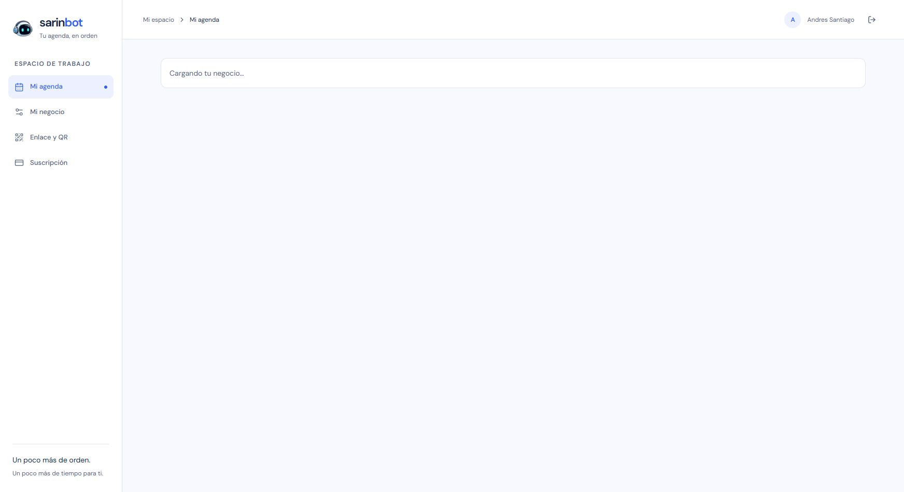

# Preparación privada de la VPS — 2026-10-14

## Alcance

Se inició una única instancia de la imagen Linux preparada de Sarin, con Node 24 y Firebase real. El puerto se publica únicamente en `127.0.0.1:3000` de la VPS; el navegador de desarrollo accede mediante un forward SSH de Tailscale en `http://localhost:3032`. No se modificaron el proxy existente ni los nameservers.

## Evidencia comprobada

- Dashboard, portada, configuración y administración devuelven HTTP 200; las nueve dependencias JavaScript del dashboard también responden correctamente.
- Catorce solicitudes a siete API protegidas, sin sesión o con un token sintético inválido, devuelven 401. Cinco rutas de archivos privados devuelven 404.
- El contenedor usa el usuario `node`, raíz de solo lectura, capacidades retiradas y montaje ADC de solo lectura. La CA privada queda fuera del montaje.
- Las credenciales Access del backend no aparecen en ninguno de los 39 archivos públicos examinados.
- El SDK dentro del contenedor en ejecución completó lecturas de Firebase Auth y Firestore con la identidad runtime.
- El propietario completó el acceso Google. Se observaron el dashboard autenticado, el formulario de negocio y el aviso de configuración pendiente del módulo QR.
- La salida deliberada del proceso Next activó el reinicio automático del contenedor. Después respondieron el dashboard y las lecturas Firebase; la sesión del navegador se conservó al recargar.
- Un mismo proceso y cliente del SDK intercambió credenciales con certificados A y B, rechazó una fuente inexistente y recuperó A. Se verificaron los certificados realmente usados por ambos agentes mTLS. El puntero activo conservó contenido, inode y fecha; los materiales de prueba se retiraron.
- Cinco archivos de pruebas aisladas pasaron: **52 pruebas**, cubriendo transporte, herramientas, autorización, doctor y selección de credenciales.

Las comprobaciones SDK no crearon usuarios, negocios, citas ni pagos. El inicio de sesión normal puede mantener el perfil de usuario. El doctor de configuración terminó sin errores, sin red; visión y UID de superadministración siguen pendientes y no bloquean texto.

## Incidencia de índices

La pantalla de suscripción devolvió 503. El diagnóstico aislado confirmó lectura de configuración correcta y fallo `requires an index` en la consulta de comprobantes. Firestore no tenía índices compuestos. Se crearon los seis índices ya definidos en `firestore.indexes.json`: todos coinciden con el manifiesto y están `READY`. También se verificó que `paymentImages.receiptDataUrl` no hereda índices ni tiene índices activos. Los metadatos anteriores y posteriores se respaldaron fuera de Git; no se modificaron documentos de negocio. [Gestión oficial de índices](https://firebase.google.com/docs/firestore/query-data/indexing).

Después pasaron la consulta sintética de comprobantes y cinco consultas de agenda desde el contenedor. La pantalla autenticada de suscripción dejó de mostrar 503 y presentó correctamente el aviso de configurar primero un negocio. Así quedan comprobados los estados iniciales de agenda, configuración, QR y suscripción; todavía no se ha creado un negocio ni probado el recorrido real del motor.

## Publicación web preparada

Se prepararon fuera de Git un bloque Caddy, overlays de red y procedimiento de reversión. El bloque pasó la adaptación con el binario Caddy real de la VPS, sin cargarlo ni recargar el proxy. Propone una red interna dedicada entre Caddy y Sarin y conserva la salida existente de Sarin hacia Firebase/Cloudflare. La dirección pública sigue pendiente de elección; el hostname de muestra no está publicado. La integración completa con el Compose y configuración compartidos exige revisión antes de aplicarse.

## Pendientes

El propietario probó un mensaje de onboarding y observó el error de conexión con la Mac. Una comprobación posterior desde el contenedor confirmó proceso activo, endpoint y modelo revisados, y presencia del par Access. El hostname del motor no se resuelve, mientras que el hostname de la web existente sí: la primera barrera confirmada es el DNS pendiente. No se enviaron credenciales al motor, no se reintentó la conversación ni se reinició la Mac. Esto no verifica el estado actual de Ollama ni sustituye las pruebas posteriores de Access y túnel.

Cambiar DNS a partir del 15 de octubre a las 16:30 de Colombia; proteger el hostname completo con Access antes de publicar las rutas; comprobar catálogo y generación real desde la VPS; validar herramientas con datos aislados; definir y publicar la dirección del panel. El reinicio de la Mac permanece pospuesto. No se han verificado alertas al operador ni recuperación tras reinicio completo de la VPS.

El forward de navegador depende temporalmente de la PC de desarrollo; el proceso Sarin y su identidad se ejecutan en la VPS. Esto es una instancia privada de pruebas, todavía sin publicación del panel ni prueba completa del motor.
