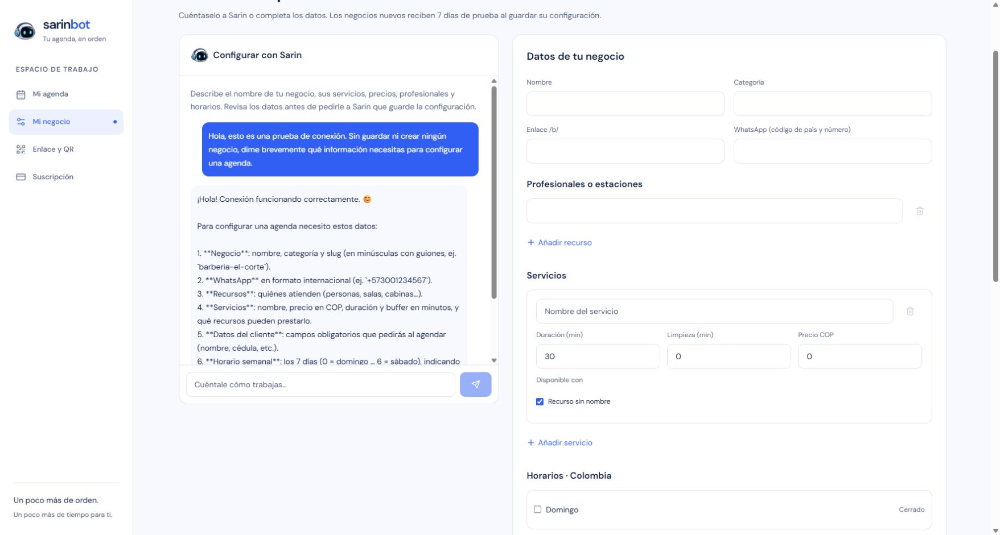

# QA histórica: proveedores manuales DeepSeek y Gemini

Actualización posterior: se retiró la integración de IA de Gemini por decisión del propietario y se revocó su clave dedicada. El historial de pruebas de esta página se conserva como evidencia de aquella versión; no describe una opción disponible actualmente. Google Sign-In, Firebase y su clave de navegador se mantienen. La selección actual entre IA local y DeepSeek se documenta en la [guía operativa](../deepseek-option-b.md).

## Estado

El propietario eligió DeepSeek como opción B manual y temporal desde el servidor y entregó una clave dedicada. Se desplegó y seleccionó `deepseek` en la instancia privada de la VPS el 15 de octubre de 2026. Después se verificó la conexión con la Mac y se devolvió el chat a **Ollama**, conservando la misma imagen y la clave DeepSeek para activación manual. El retorno y su prueba en pantalla están en la [QA de conexión local](2026-10-15-dns-cutover.md). En aquella versión, Gemini se implementó como tercera opción y se probó con datos ficticios, pero no se activó ni se instaló su clave en la VPS; la cuenta permaneció en nivel gratuito. No se autorizó ni habilitó facturación Google.

El valor predeterminado del código sigue siendo Ollama. Vault lo selecciona explícitamente en sus tres caminos (texto, transcripción y análisis), con salud independiente y almacenamiento local del navegador. No hay conmutación automática ni reintento con otro proveedor.

## Verificación de código de aquella versión

- TDD del transporte: **56 pruebas del motor** pasan. Cubren cabeceras y opciones independientes, imágenes rechazadas en cloud, respuestas limitadas, cancelación, redirecciones, errores seguros y firmas de herramientas Gemini.
- Salud: autorización antes del probe, Vault exclusivo de superadministrador y cachés independientes. Vault permanece en Ollama aunque el chat seleccione cualquiera de las APIs.
- La revisión independiente detectó herencia cloud en `dev:local`. Se observaron fallos antes de corregirla; el launcher fija Ollama y valores cloud vacíos, incluso ante carga posterior por dotenv. `test:journey` rechaza credenciales y selección cloud.
- `pnpm test`: **227 pasan, 8 omitidas**; 25 archivos pasan y 3 omitidos. Las omitidas requieren recorridos/emuladores externos; no se afirma haberlos ejecutado en esta revisión.
- `pnpm run build`: Next 16.4.0 compiló, verificó TypeScript y generó las páginas correctamente tras el último cambio. Node 24.18.0 y pnpm 11.23.0.
- `pnpm audit --audit-level=high`: ninguna vulnerabilidad conocida informada; no se modificaron dependencias después.
- Revisión independiente final: sin otros defectos concretos detectados en los límites de proveedores, Vault o salud.

## Pruebas reales sintéticas

Se ejecutó el cliente real `completeChat`/`probeEngine` con las claves privadas locales, sin imprimirlas ni usar clientes reales. Cada proveedor completó catálogo autenticado, llamada a la herramienta sintética `sarin_healthcheck` y una segunda respuesta con el resultado `SARIN_OK`. La herramienta no accede a Firebase ni crea negocios o reservas.

DeepSeek pasó las dos rondas. La primera comprobación de Gemini detectó que su catálogo devuelve identificadores con el prefijo `models/`; se corrigió la comparación exclusivamente para Gemini, con pruebas de regresión, y después pasó el recorrido completo conservando la firma opaca de Google. La generación consumió una cantidad pequeña de saldo DeepSeek y cuota gratuita Gemini; no se efectuaron recargas ni cambios de plan.

La prueba vive fuera de Git en `%LOCALAPPDATA%/SarinBot/deployment/provider-live.test.ts`, con configuración privada. La suite normal usa transporte simulado y no llama a las APIs.

Tras activar la imagen se hizo una prueba independiente desde el contenedor en ejecución, usando exclusivamente su clave runtime y el destino fijo DeepSeek: **tres solicitudes, todas HTTP 200** (catálogo y dos completions), herramienta sintética validada y respuesta final `SARIN_OK`. Duración 1,809 s, máximo 128 tokens por completion, razonamiento desactivado y cero reintentos. Esto verifica credencial instalada, salida de red, capacidad de generar y soporte de herramientas desde la VPS; no sustituye el recorrido HTTP autenticado de la aplicación ni la prueba en pantalla.

Registro sanitizado: `%LOCALAPPDATA%/SarinBot/deployment/sarin-deepseek-post-deployment-20261015T231909Z.json`.

## Despliegue y controles posteriores

Imagen de aquella activación: `sarin-bot:option-b-20261015t231909z`, ID `sha256:f3a7e50352af01ce38e5a53e5aad2c15fe61b97483714781c6e46b39eef199db`. El paquete contiene 85 archivos de aplicación y configuración de build, SHA-256 `7c0158d4a8ef4e433a4a211f234b822df0e9f2d1cd489c59c84b25e422c4026c`. Se verificó su correspondencia con las fuentes finales. El contexto no incluye secretos, entornos privados, docs, work ni tests.

La clave DeepSeek se transfirió por stdin de SSH a un archivo privado root:root 0600, sin argumentos de proceso ni logs con el valor. El script revisado se ejecutó una sola vez y terminó con código 0. Actualizó únicamente la imagen y tres variables de DeepSeek. Todos los demás valores runtime, incluidos Ollama, Access y ADC, coinciden exactamente con el respaldo.

Después del cambio:

- 14 solicitudes sin sesión o con token inválido devolvieron 401; cinco rutas privadas, 404.
- Páginas y nueve dependencias JavaScript devolvieron 200.
- Firebase Auth y Firestore completaron lecturas con la identidad del contenedor.
- Una sola réplica, usuario `node`, raíz y montaje ADC de solo lectura y puerto exclusivamente loopback.
- Proveedor `deepseek` y clave presentes; clave Gemini ausente.
- Escaneo de 39 archivos públicos con los valores reales de los secretos runtime: cero coincidencias. Los valores nunca se imprimieron.

La configuración anterior y la imagen `sarin-bot:staging-20261014t232158z` se conservan. Respaldo verificado: `/opt/sarin-bot/runtime/rollbacks/option-b-20261015T231739Z`. El rollback comprueba integridad y rechaza sobrescribir cambios posteriores, pero **no fue ejercitado** al resultar satisfactoria la activación. El sello de la carpeta usa el reloj de la VPS, que difiere del reloj de la sesión; la activación quedó observada a las 23:22:20 UTC de la sesión.

El script privado de aquella activación/reversión es `/opt/sarin-bot/staging/option-b-20261015T231909Z/activate-rollback.py`. Su rollback restaura la imagen y configuración anteriores a la integración; **no usarlo para alternar proveedores después del retorno a Ollama**, ya que el runtime cambió y sus guardas rechazan sobrescribirlo. La reversión del cambio posterior de proveedor y DNS, que mantiene la imagen actual, se documenta en la [QA de conexión local](2026-10-15-dns-cutover.md).

Evidencia sanitizada privada: `%LOCALAPPDATA%/SarinBot/deployment/sarin-option-b-activation-20261015T231909Z.json`, manifiesto y registro de build del mismo identificador. Se preservaron los cambios de trabajo previos. El soporte de proveedores se publicó después en `main`, commit `a5ece3e`.

## Límites pendientes

La instancia continúa privada y se accede temporalmente mediante SSH en `http://localhost:3032/dashboard/onboarding`. Después de que el propietario completara el acceso Google, se verificó el chat autenticado en pantalla el 15 de octubre a las 23:26 UTC (18:26 de Colombia). Se envió una sola solicitud sintética para consultar qué información necesita una agenda, indicando expresamente no crear ni guardar un negocio. Sarin devolvió una respuesta coherente en español y el formulario de negocio permaneció vacío. Queda comprobado el recorrido navegador → API autenticada de la VPS → DeepSeek → respuesta visible. No se creó un negocio ni se probó una reserva real; la prueba de herramientas sintéticas es la descrita arriba.

La prueba histórica de Gemini se limitó a datos sintéticos; no se trasladó su clave al servidor ni se autorizó su uso con conversaciones de clientes. Esa integración y su guía de activación se retiraron posteriormente.

La conexión completa con Ollama se verificó después: DNS nativo del contenedor, Access, catálogo y respuesta del chat autenticado en pantalla. El diagnóstico de Luis confirmó LaunchAgent activo y Ollama HTTP 200; no se reinició ni reinstaló la Mac. La [evidencia de conexión local](2026-10-15-dns-cutover.md) documenta la corrección DNS exclusiva del contenedor y el retorno a Ollama. La publicación web y el DS nuevo son trabajos separados pendientes.

La revisión de solo lectura anterior al retorno mantuvo `ENOTFOUND` para el hostname del motor desde el contenedor. Tailscale mostró la Mac `Online=true`, con `LastSeen=2026-10-15T23:00:00.1Z`; ese estado por sí solo no demostraba funcionamiento del conector Cloudflare ni de Ollama. Las comprobaciones posteriores superaron ese límite.

Guía operativa vigente: [IA local y DeepSeek](../deepseek-option-b.md).
