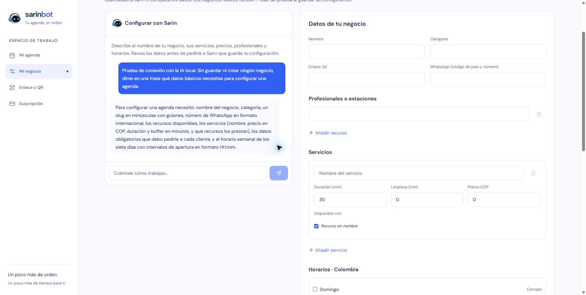

# QA del cambio DNS y protección del motor — 2026-10-15

Resultado final operativo del 2026-10-15: **Ollama está activo en la VPS y respondió desde el chat autenticado del panel**. La resolución se corrigió únicamente para `app` en Compose mediante el secundario `46.38.225.230`, manteniendo intacto el resolver del host. Pasaron DNS nativo del contenedor, catálogo 200 con el modelo esperado, `/api/tags` 404 y los 16 controles de autenticación, páginas, assets y Firebase antes y después. DeepSeek queda como respaldo manual con su clave retenida y Gemini continúa ausente del runtime. Las comprobaciones finales del motor, modelo instalado y generación del diagnóstico pasaron desde la VPS con DNS nativo. El historial y los límites de cada comprobación se conservan abajo.

## Alcance y autorización

El propietario había autorizado retirar el DS, esperar 24 horas, cambiar los NS y esperar otras 48 horas antes de publicar el DS Cloudflare. El 2026-10-15 solicitó cambiar los NS después de verificar nuevamente los DNS. Solo se utiliza `alsdevstudio.com` para el motor. La prueba de reinicio de la Mac sigue pospuesta; no se provocó un reinicio ni se reinstaló el conector.

## Verificación previa

- Retirada del DS confirmada el 2026-10-14 a las 21:28:40.297 UTC; corte operativo permitido desde el 2026-10-15 a las 21:30 UTC, 16:30 Colombia.
- Consulta directa del 2026-10-15 a `a.gtld-servers.net` (`192.5.6.30`) a las 22:40:56.891634 UTC y a `j.gtld-servers.net` (`192.48.79.30`) a las 22:40:56.892872 UTC: tipo DS, NOERROR, AA=true, TC=false, cero respuestas DS y autoridad con NSEC3, SOA y RRSIG.
- Ambos `.com` todavía delegaban en los cuatro NS Porkbun. Google `8.8.8.8` y Cloudflare `1.1.1.1` también devolvieron NOERROR sin DS.
- Se cotejaron los siete registros en ambas interfaces, contra el respaldo y mediante consultas a los cuatro NS Porkbun y los dos Cloudflare. Los siete registros existentes se conservaron DNS only y TTL 600.

| Registro | Valor conservado |
| --- | --- |
| Apex ALIAS → CNAME aplanado | `uixie.porkbun.com` |
| CNAME `www` | `alsdevstudio.pages.dev` |
| MX apex, prioridad 10 | `fwd1.porkbun.com` |
| MX apex, prioridad 20 | `fwd2.porkbun.com` |
| TXT SPF apex | `v=spf1 include:_spf.porkbun.com ~all` |
| TXT `_acme-challenge`, primero | Coincide íntegramente con el respaldo local |
| TXT `_acme-challenge`, segundo | Coincide íntegramente con el respaldo local |

El apex resolvió en los seis NS a `207.207.210.23`, `207.207.210.36` y `207.207.210.50`; las consultas AAAA no devolvieron direcciones. El ALIAS/CNAME aplanado no publica un CNAME en el apex. Una consulta UDP adicional a una dirección de Sullivan agotó el tiempo de espera; otra dirección del mismo NS devolvió NOERROR y SOA para esa consulta. Esto no se interpretó como ausencia probada a partir del timeout.

Los cuatro NS Porkbun todavía publicaban DNSKEY y RRSIG antes del cambio. `https://alsdevstudio.com/` terminó en `https://www.alsdevstudio.com/`, con HTTP 200; `www` también respondió 200 directamente.

## Cambio y plazo DNSSEC

Se guardaron en Porkbun únicamente `june.ns.cloudflare.com` y `sullivan.ns.cloudflare.com`. La delegación `.com` devolvió ambos NS nuevos a las siguientes horas:

| Servidor consultado | Primera observación UTC |
| --- | --- |
| `a.gtld-servers.net` | 2026-10-15 22:41:41.959269 |
| `j.gtld-servers.net` | 2026-10-15 22:41:41.959739 |

T0 común: **2026-10-15 22:41:41.959739 UTC**. El DS Cloudflare no debe publicarse antes del **2026-10-17 22:41:41.959739 UTC**, equivalente a **17:41:41.959739 Colombia**. Se adopta como margen operativo **22:45 UTC / 17:45 Colombia**, después de volver a verificar el estado DNS. No se publicó un DS nuevo ni se programó una automatización.

Tras el cambio, las consultas TCP DS a ambos servidores `.com` a las 22:42:29.133833 y 22:42:29.252911 UTC devolvieron NOERROR, AA=true, TC=false, cero DS y pruebas NSEC3/SOA/RRSIG. Se usó TCP para resolver dos timeouts UDP de `j.gtld`; los timeouts no se tomaron como prueba negativa.

La UI de Cloudflare confirmó la zona activa. Los recursivos mostraron cachés distintas: Google devolvió los NS nuevos en una consulta y los anteriores en otra; Cloudflare aún devolvía los anteriores. La delegación del padre sí estaba actualizada. Mantener los siete registros equivalentes y su respaldo durante la transición de 48 horas.

Los MX y SPF conservados coinciden con la [guía oficial de Porkbun para email y forwarding con DNS externos](https://kb.porkbun.com/article/47-how-to-use-porkbun-email-when-your-dns-is-hosted-elsewhere). No se envió correo de prueba ni se verificó entrega extremo a extremo.

## Access y ruta del motor

- Aplicación: `Sarin — motor Ollama ALS`, ID `da69b6e4-7ca0-4590-92fe-380f589ac6bc`.
- Dominio protegido completo: `ia-sarin.alsdevstudio.com`, sin limitar Access a una ruta.
- Política: `Sarin backend únicamente`, ID `10e637f9-b3c6-441c-83f0-8c9170e13fba`, acción `Service Auth` y único selector `Service Token` para `sarin-local-backend`. El selector se inspeccionó antes de guardar; la asociación de la política y el dominio completo se confirmaron después en el listado guardado.
- Ruta creada después de Access: `^/v1/(chat/completions|models)$` hacia `http://127.0.0.1:11434`, con `httpHostHeader: 127.0.0.1:11434`.
- DNS nuevo del motor: CNAME con proxy y TTL Auto a `baac8f41-73ac-45e9-a394-59260ea07e25.cfargotunnel.com`. El listado final de Cloudflare mostró ocho registros: este registro nuevo y los siete originales, conservados DNS only y TTL 600.

La UI consultada no mostró la regla final del túnel. El requisito sigue siendo terminar en `http_status:404`. El rechazo autenticado de `/api/tags` estaba pendiente en esta revisión inicial; la comprobación posterior dio 404, como se registra abajo. Ese comportamiento no acredita haber leído toda la configuración final de ingress.

Ambos NS Cloudflare resolvieron `ia-sarin.alsdevstudio.com` a `172.67.189.108` y `104.21.49.86`. El resolver local y `1.1.1.1` conservaron NXDOMAIN durante la comprobación. Se consultó HTTPS mediante `curl --resolve`, fijando una dirección obtenida del NS autoritativo y manteniendo el hostname, SNI y validación normal de TLS; no se utilizó `--insecure`.

| Prueba HTTPS | Resultado |
| --- | --- |
| `/v1/models`, sin credenciales Access | HTTP 403 |
| `/v1/models`, con credenciales deliberadamente inválidas | HTTP 403 |
| `/`, sin credenciales Access | HTTP 403 |
| `/api/tags`, sin credenciales Access | HTTP 403 |
| `/v1/chat/completions`, sin credenciales Access | HTTP 403 |
| `/v1/models`, con credenciales válidas desde la VPS | Pendiente en la revisión inicial; resultado posterior abajo |

Esos 403 iniciales verificaron rechazo en Cloudflare. Por sí solos no demostraban aceptación del token válido, llegada a Ollama ni inferencia; las pruebas posteriores se documentan abajo.

## Observaciones iniciales y seguimiento

Cloudflare mostró inicialmente `sarin-mac-ollama` en estado `Down`, con cero réplicas; la revisión de las 22:47:43 UTC mantuvo ese estado. La consulta de solo lectura desde la VPS de las 22:47:52 UTC identificó el peer exacto `MacBook Pro de Luis`, con `Online=false` y `LastSeen=2026-10-15T22:40:00.1Z`; también verificó la configuración correcta del backend y obtuvo `ENOTFOUND` al resolver el motor. El propietario confirmó que la Mac estaba encendida, con Internet y sesión Luis iniciada. Se solicitaron el estado local del LaunchAgent y el código HTTP de `/v1/models`; sus resultados se recibieron después y constan en la siguiente sección. Las cuatro conexiones y HTTP 200 del 2026-10-14 se conservan como evidencia histórica. No se determinó la causa de aquella desconexión.

La nueva comprobación DNS del backend a las **22:44:56 UTC** del 2026-10-15 todavía devolvió `ENGINE_HOSTNAME_NOT_FOUND`. Las pruebas mediante IP explícita no sustituyen la resolución y conexión normal desde la VPS.

## Verificación posterior: Mac, DNS y transporte

El propietario entregó la salida local de `launchctl`: `state = running`, PID 71314 y sin salidas previas del proceso. Ollama devolvió HTTP 200 en `/v1/models` por loopback de la Mac. La UI actualizada de Cloudflare mostró `Healthy` y dos conectores activos de la misma Mac. No se reinició ni se reinstaló el conector; la ruta permaneció igual. No se modificaron permisos de Tailscale.

Entre **23:32:49 y 23:33:18 UTC (18:32:49–18:33:18 Colombia)**, ambos NS autoritativos respondieron correctamente para el motor. `1.1.1.1` y `8.8.8.8` devolvieron los NS Cloudflare y A/AAAA correctos; el resolver predeterminado de Windows también resolvió. Los A fueron `172.67.189.108` y `104.21.49.86`, con TTL 300. Algunas consultas UDP a Sullivan agotaron el tiempo; otras direcciones del mismo NS y TCP respondieron NOERROR, AA=true. No se observó error autoritativo de contenido. Ambos servidores `.com` mantuvieron la delegación Cloudflare y DS ausente con NOERROR, AA=true y pruebas NSEC3/SOA/RRSIG; el plazo de 48 horas no cambia.

| Comprobación posterior | Resultado y alcance |
| --- | --- |
| VPS, `/v1/models` con Access válido, hostname original y resolución diagnóstica a IP autoritativa | HTTP 200; catálogo incluye `qwen3.8:27b-q4_K_M` |
| VPS, sin Access o con credenciales inválidas, mismo diagnóstico | HTTP 403 |
| VPS, `/api/tags` con Access válido, mismo diagnóstico | HTTP 404; verifica esa ruta, no la lectura de toda la configuración ingress |
| VPS, DNS nativo del runtime, antes de la corrección | `ENOTFOUND`; pendiente en esa revisión |
| Windows, cliente real importado `probeEngine` y `completeChat`, con DNS nativo | Catálogo y conversación sintética de dos rondas con herramienta correctos, en 13,24 segundos, a las 18:34:40 Colombia (23:34:40 UTC) |

Las pruebas diagnósticas de la VPS conservaron hostname, SNI y validación TLS normal. No sustituyen la resolución nativa de ese equipo. La prueba sintética de Windows verifica el cliente real y el recorrido por Access hacia Ollama; no acredita inferencia desde el contenedor VPS ni el cambio del proveedor del panel.

**En esa revisión, DeepSeek continuaba activo.** Quedaban por resolver y verificar DNS normal desde la VPS, repetir catálogo e inferencia allí, ejecutar `pnpm run doctor --engine` y `pnpm run doctor --generate`, y realizar el cambio explícito a Ollama con su comprobación del panel. No se cambió ningún proveedor durante esa comprobación. El resultado de la restauración posterior se documenta a continuación; la publicación pública y la prueba de reinicio pospuesta mantienen su estado pendiente.

A las **23:38:59 UTC (18:38:59 Colombia)**, la revisión desde la VPS identificó caché anterior en el upstream activo del host `46.38.252.230`: cuatro NS Porkbun, TTL aproximado de 82.958 segundos, y NODATA para el motor con SOA Porkbun y TTL negativo 1.800 segundos. El secundario ya configurado, `46.38.225.230`, devolvió los NS Cloudflare y direcciones correctas. Las consultas UDP de la VPS a resolvers públicos agotaron el tiempo; las consultas TCP funcionaron. La evidencia quedó fuera de Git en `sarin-vps-dns-root-cause-20261015T233859Z.json`. Durante ese diagnóstico aún no se habían modificado resolvers ni aplicado una excepción DNS al contenedor.

## Restauración de Ollama en el backend y comprobación del panel

El script privado revisado finalizó con código 0 y mantuvo la misma imagen de la aplicación. Cambió únicamente `SARIN_CHAT_PROVIDER` de `deepseek` a `ollama` en el entorno y configuró `dns: 46.38.225.230` solo para el servicio `app` de Compose. El resolver del host, las rutas del túnel y los controles de Access permanecieron intactos. La clave DeepSeek se conservó para respaldo manual; Gemini continúa ausente del runtime.

| Verificación tras recrear `app` | Resultado |
| --- | --- |
| Resolución DNS nativa dentro del contenedor | Correcta |
| `/v1/models` autenticado | HTTP 200, con `qwen3.8:27b-q4_K_M` |
| `/api/tags` autenticado | HTTP 404 |
| Controles de autenticación | 16 comprobaciones correctas antes y después |
| Páginas, assets y lecturas Firebase | Correctos antes y después |
| Onboarding autenticado, recargado por acceso privado en puerto 3032 | Una consulta sintética nueva recibió una lista coherente en español |
| `doctor --engine` | Correcto |
| Primera prueba breve `doctor --generate` | HTTP 200, `finish_reason: length`, texto final vacío y presupuesto de 32 tokens consumido en razonamiento |
| Diagnóstico final desde la VPS, con DNS nativo | Motor, modelo principal instalado y generación correctos; código 0 hacia las 23:44:42 UTC |

La comprobación del panel no guardó ni creó negocios; su formulario quedó vacío. La prueba anterior del cliente real desde Windows también había verificado dos rondas con herramienta sintética en 13,24 segundos.

El fallo inicial del diagnóstico breve se debió al presupuesto consumido en razonamiento, no a la red. La corrección de una línea reemplazó `think: false` por `reasoning_effort: 'none'`, conforme al [contrato OpenAI de Ollama](https://docs.ollama.com/api/openai-compatibility). Se actualizó únicamente la copia privada `/opt/sarin-bot/diagnostics/lib/doctor.mjs`, con respaldo `doctor-before-reasoning-fix-20261015.mjs`; no se cambió la imagen de la aplicación. La repetición desde la VPS pasó con DNS nativo. La validación local posterior dio 229 pruebas aprobadas y 8 omitidas, 27 aprobadas en la suite dirigida del diagnóstico y typecheck correcto.

Estos resultados no significan que toda la configuración esté completa: visión sigue sin configurar y el UID superadmin continúa pendiente. Las variables cliente Firebase no están presentes en el entorno de runtime; su cliente compilado sí fue comprobado desde la UI. El resumen final de evidencia se conserva fuera de Git en `sarin-ollama-final-verification-20261015.json`.

El respaldo de entorno y Compose permanece fuera de Git en `/opt/sarin-bot/runtime/rollbacks/restore-ollama-dns-20261015T233822Z-581f0478`. El reloj de la VPS difiere aproximadamente cuatro minutos; el sello del nombre del respaldo no determina el orden de las observaciones UTC de esta QA. El script privado `/root/sarin-restore-ollama-dns-reviewed.py` acepta `rollback BACKUP`, con ese directorio como argumento, para restaurar entorno y Compose con la misma imagen. No se ejecutó rollback. La publicación pública, visión y pruebas de reinicio mantienen sus límites previos.

## Evidencia y reversión

La evidencia DNS pública y los respaldos completos se guardaron fuera de Git, bajo `%LOCALAPPDATA%/SarinBot/dns-backups`:

- `alsdevstudio.com-before-cloudflare-2026-10-14.json`
- `alsdevstudio.com-preflight-2026-10-15.json`
- `alsdevstudio.com-preflight-followup-2026-10-15.json`
- `alsdevstudio.com-postcutover-2026-10-15T224148Z.json`
- `alsdevstudio.com-postcutover-2026-10-15T224206Z.json`
- `alsdevstudio.com-ds-postcutover-tcp-2026-10-15T224229Z.json`

Las pruebas de rechazo HTTPS se registraron en `%LOCALAPPDATA%/SarinBot/cloudflare/sarin-access-negative-probes-2026-10-15.json`. El plan privado `%LOCALAPPDATA%/SarinBot/cloudflare/sarin-als-connection-plan.json` se actualizó con el nuevo estado. La revisión adicional del backend y la Mac se conserva en `%LOCALAPPDATA%/SarinBot/deployment/sarin-engine-and-mac-recheck-2026-10-15T224752Z.txt`. Las credenciales de Access y del conector permanecen fuera de Git y no se incluyen en esta evidencia. Los IDs de configuración documentados no son credenciales.

Para retirar el motor, mantener Access hasta quitar la ruta y el DNS; después revocar el token si corresponde. Si fuera necesario revertir la delegación, verificar DS ausente y restaurar exclusivamente `curitiba.ns.porkbun.com`, `fortaleza.ns.porkbun.com`, `maceio.ns.porkbun.com` y `salvador.ns.porkbun.com`, conservando los registros respaldados. No publicar un DS incompatible durante la reversión ni considerar que quitar Access sea un mecanismo de rollback seguro.

Contexto y restricciones: [conexión de la Mac](../remote-ollama-connection.md). La [QA del 2026-10-14](2026-10-14-vps-pre-dns.md) conserva el estado histórico anterior al cambio.
