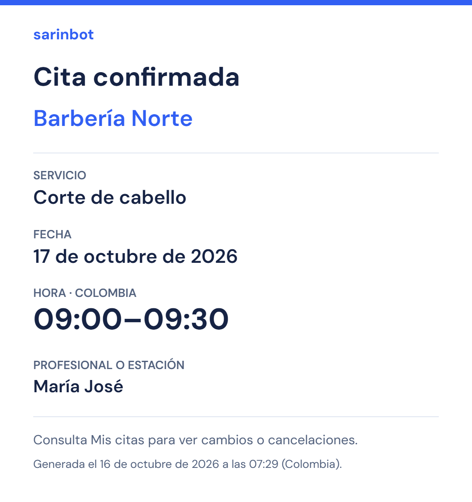

# Imagen de la cita en lugar de ICS

Petición del propietario: sustituir la descarga de calendario por una imagen fácil de guardar y compartir. Estado: implementación, QA local y publicación verificadas.

## Cambio

«Mis citas» ofrece **Guardar imagen de la cita** en reservas futuras confirmadas. Genera un PNG local con negocio, servicio, fecha, hora de Colombia y nombre del profesional/estación si existe en el catálogo actual. No exporta correo, teléfono, UID ni respuestas del formulario. No añade API, almacenamiento, dependencia o llamada de IA.

La imagen incluye su fecha de generación y remite a «Mis citas» para cambios/cancelaciones: es un recordatorio estático, no una consulta vigente del servidor. La hora termina al acabar el servicio, sin incluir el margen de preparación. Un nombre de recurso actual no es una instantánea histórica si el negocio lo cambia.

La interfaz bloquea acciones simultáneas y vuelve a comprobar identidad, negocio, estado, horario y datos después de generar el PNG. Un resultado tardío se descarta tras cambiar de cuenta, cancelar, iniciar la cita o modificar sus datos. Los textos se dibujan como texto Canvas, sin HTML ni recursos remotos.

## Evidencia

- Prueba RED: cuatro casos nuevos fallaron antes del cambio por ausencia de la descarga PNG; las 13 pruebas existentes continuaron pasando.
- `pnpm test tests/client-appointments.test.tsx`: 17 aprobadas, incluyendo error/reintento, doble clic, cambio de cuenta y cancelación durante generación.
- `pnpm test`: **682 aprobadas, 20 omitidas**.
- `pnpm run typecheck`: correcto.
- Build Docker Linux/amd64 congelado: correcto, incluida compilación Next y comprobación de tipos.
- `pnpm run build:landing` y `pnpm run check:landing`: correctos; 41 archivos públicos.
- Revisión independiente sin hallazgos bloqueantes de seguridad o coherencia.

El navegador Chrome accedió con **Cliente local** a `demo-sarin-bot` y emuladores oficiales en loopback. Dos citas futuras sintéticas produjeron archivos reales: PNG **1080×1148, 134.235 bytes**, y texto largo **1080×1263, 166.701 bytes**. Se comprobaron firma PNG, medidas y contenido visual: tildes correctas, servicio, fecha y horas 09:00–09:30 / 10:00–10:30. La reserva cancelada no mostró acción de descarga. Vista móvil 390 px, sin desbordamiento horizontal; el cambio temporal de viewport se retiró.

[Texto largo](2026-10-16-appointment-image-long.png) · [Botón y descarga en móvil](2026-10-16-appointment-image-mobile.png).

No se hicieron inferencias ni escrituras de producción para preparar estas citas. Safari/iOS y Android nativos no se probaron con un dispositivo real; la comprobación móvil usó Chrome con viewport reducido. No se promete guardar automáticamente en la galería ni enviar por WhatsApp.

## Publicación y reversión

No requiere migración de datos. La reversión conserva D1/R2 y vuelve a la imagen comercial anterior `sha256:3c416933dbc6ec618e71fd6d6199ae162a17889fb87ea24f58aab3c89ef44c01`, bajo mantenimiento y conservando una sola instancia. No volver a Firestore ni arrancar el runtime VPS.

Imagen nueva construida y subida:

`registry.cloudflare.com/05fb22c155667de064b55c4e287b21d8/sarin-bot-appointment-image@sha256:7fbae3dc412ab67a5613816a6581d750ebe4a20369e76cebe58ca47826bf96f7`

Copia privada de 124 archivos fuente en `%LOCALAPPDATA%/SarinBot/commercial-acceptance-2026-10-16/source-appointment-image-20261016`; manifiesto SHA-256 `f1688606062ba946655258e6d18d71c058d8352d251482239c9a9313cff4642e`. El archivo `wrangler-before.json` conserva la configuración D1 anterior para reversión. El checkout mantiene cambios de fases anteriores; no se hizo un commit masivo.

Mantenimiento inicial: Worker `bfbbd8fd-3a06-4451-ab80-aaa3728a063f`, portada pública HTTP 503. Se comprobó cola 0 activa/0 en espera antes **y después** de cerrar, mediante el diagnóstico administrativo existente `scope=engine`. Para reutilizar la sesión del navegador se cambió temporalmente solo esa URL de diagnóstico mediante CDP; no se extrajeron encabezados o tokens y la interceptación quedó retirada (`Fetch.enable` sin patrones). El proveedor guardado no cambia con esta consulta de Ollama.

Rollout de imagen bajo mantenimiento: Worker `965fe879-da57-4672-ae07-a3e5ef654248`. Comprobación independiente previa a reabrir, 12:33:21 UTC: versión 5, imagen nueva, D1, 13 secretos preservados, mantenimiento activo y cero registros antiguos, con paginación completa.

Worker final **`82361d3f-2e3a-4830-8785-ecfc678bfc68`**. Tras reabrir, `/`, `/ayuda`, `/privacidad` y la página del negocio devolvieron 200; `/api/session` sin credencial devolvió 401. La portada y ayuda publicadas contienen la descarga de imagen y no el texto de archivo ICS. Los nueve scripts públicos de la página de negocio incluyen la acción PNG y el generador Canvas; no incluyen el botón anterior «Guardar en mi calendario». La sesión administrativa volvió a cargar, con DeepSeek disponible/activo, cola 0/4 y 0 en espera. No se generaron nuevas reservas o llamadas IA de producción para esta comprobación.

Checkpoint independiente de plataforma, **12:35:24 UTC**: versión 5 e imagen nueva, D1, mantenimiento desactivado, 13 secretos y cero registros antiguos, paginación completa. La única asignación nueva figuraba inactiva en esa lectura; no se afirma una instancia permanentemente encendida ni `running:1`. Las respuestas HTTP y la carga autenticada anteriores verifican disponibilidad tras la reapertura, sin sustituir esa lectura de ciclo de vida.

[Captura de la descripción publicada](2026-10-16-appointment-image-live-copy.png). Los cinco documentos del fixture local se retiraron explícitamente del emulador; el navegador de prueba y los procesos locales de Next/Auth/Firestore se cerraron al terminar.

DeepSeek debe conservarse como proveedor activo. Los resultados ICS del [recorrido comercial anterior](2026-10-16-commercial-e2e.md) son históricos y no describen la descarga posterior a este cambio.
