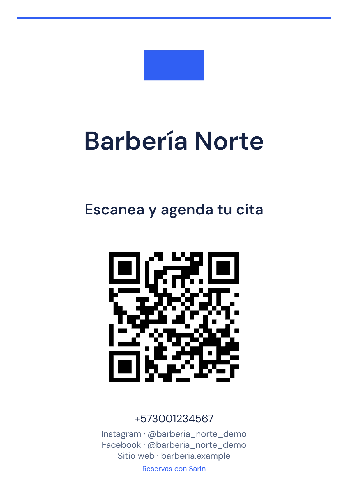

# Identidad del negocio y tarjeta Agenda clara

Estado al 16 de octubre de 2026: contratos, servidor, almacenamiento, renderizador e interfaz implementados en el worktree `commercial-pilot`, con pruebas automatizadas y **aceptación local de la tarjeta A en navegador real**. Exportaciones PDF/PNG/SVG descargadas, dimensiones comprobadas, render inspeccionado y QR decodificado; kit y perfil revisados a 320 px. **La impresión física, la operación con negocios reales y la publicación en producción siguen pendientes.**

## Alcance implementado

Se usa únicamente **A / Agenda clara**, elegida por el propietario. La tarjeta da prioridad al negocio: logo o iniciales, nombre, teléfono público, hasta tres enlaces sociales y «Escanea y agenda tu cita», con firma discreta «Reservas con Sarin». No hay selector de estilos. Las muestras B/C se conservan como referencias y el QR de demostración de los artes anteriores no se importa a la aplicación.

La configuración conserva `phoneWhatsApp` y admite hasta tres enlaces de Instagram, Facebook, TikTok o sitio web, con plataforma única y validación de URL HTTPS. Los dominios de redes se comprueban de forma exacta; los enlaces no se descargan para preparar la tarjeta. La normalización conserva el identificador necesario de los perfiles Facebook `profile.php?id=...`. Omitir redes en un payload antiguo conserva las existentes; enviar `[]` las elimina. La proyección pública enumera contactos válidos y solo el digest del logo, sin bytes, claves R2, correo del propietario ni nuevos datos privados.

El formulario añade controles de logo y redes; estas últimas se guardan con el envío explícito de la configuración. Un borrador modificado conserva su instantánea completa ante sondeos y cambios del logo. Guardar establece una nueva base, sin perder ediciones realizadas mientras respondía la solicitud. La foto personal de Google se conserva. La página actual `/b/[slug]` incorpora logo y contactos sin retirar su autenticación ni modificar reservas.

El kit consulta datos guardados al servidor, muestra el enlace completo y ofrece preparar la tarjeta, vista previa, abrir PDF y descargar `tarjeta-<slug>.pdf`, `tarjeta-<slug>.png` y `qr-<slug>.svg`. No persiste tarjetas ni PDFs en la base o R2, no utiliza IA y no añade un editor gráfico libre.

## Logo, permisos y concurrencia

`POST /api/businesses/logo` exige sesión, negocio propio y derecho comercial vigente. No admite un ID de negocio elegido por el navegador. La comprobación se repite dentro de la transacción. El JSON se limita a 3 MiB; la imagen de entrada a **2 MiB** y formatos PNG/JPEG/WebP estáticos. Se validan base64 canónico, firma, formato decodificado, dimensiones de hasta 4096 por lado, límite de 16.777.216 píxeles y ausencia de animación. Archivos corruptos, SVG disfrazado, formatos incompatibles y excesos se rechazan.

Sharp orienta y encaja sin recortar en **512 × 512 px** con relleno transparente, elimina EXIF y genera WebP calidad 85, máximo **256 KiB**. La cuenta Google no se modifica.

La escritura compara `expectedSha256` con el digest vigente: dos sustituciones concurrentes desde la misma versión no pueden sobrescribirse silenciosamente; la obsoleta recibe 409 `BRANDING_CHANGED`. Repetir el mismo logo ya activo es idempotente. Negocio, documento de imagen y proyección pública cambian transaccionalmente. Al eliminar o sustituir se retira el documento anterior; no se realiza una limpieza destructiva de objetos R2.

Los bytes usan la colección `businessLogos` y el prefijo privado **`business-logos/<sha256>`**, separados de comprobantes `payment-images/`. En D1, el adaptador externaliza la imagen a R2 antes del CAS y conserva metadata en `app_documents`; solo una lectura directa hidrata bytes y verifica tamaño/hash. Una falla de escritura R2 no publica un documento incompleto. Un conflicto posterior puede dejar un objeto privado huérfano, conforme al comportamiento existente. Firestore/emuladores usan la misma abstracción `Database` con el data URL normalizado limitado.

La ruta pública `/api/public/businesses/[slug]/logo/[sha256]` exige que la proyección publicada del negocio siga apuntando a ese digest; una versión retirada devuelve 404. Sirve solo WebP con `no-store`, `nosniff` y `Cross-Origin-Resource-Policy: same-origin`, sin CORS permisivo ni bucket público. Las reglas de Firestore deniegan al cliente acceso directo a los documentos de logos.

## Enlace estable y generación de archivos

`GET /api/businesses/qr-kit` requiere propietario y configuración completada. El servidor construye la URL a partir de **`SARIN_PUBLIC_BOOKING_ORIGIN`**, no de `window.location.origin`, Host o Forwarded. La configuración revisada en el worktree declara `https://sarinbotsaas.pages.dev`; este registro no afirma que ese cambio se haya aplicado a producción. El desarrollo aislado configura loopback y proyecto `demo-*`.

Se rechazan orígenes ausentes o inválidos y hosts de preview no autorizados; el error bloquea el kit en lugar de inventar una URL. El slug permanece inmutable. Cambiar logo, nombre, teléfono o redes conserva el destino del QR; el propio QR contiene únicamente la URL de reservas. Antes de una tirada real hay que confirmar el dominio mostrado y conservar redirecciones desde el dominio impreso si se cambia más adelante.

El layout declara **1241 × 1749 px**, equivalente a A6 a **300 ppp** con redondeo. El PDF contiene **el mismo PNG** en una sola página de **105 × 148 mm**, sin sangrado; no promete texto seleccionable ni una composición vectorial como los PDFs de muestra. El SVG descargado corresponde únicamente al QR. El QR real se genera con `qrcode.react`: nivel M, negro sobre blanco, cuatro módulos de zona libre, sin imagen superpuesta y cuadrado de **591 px**, aproximadamente **50 mm** a 300 ppp. La información esencial se mantiene dentro del margen de 5 mm.

DM Sans se carga desde el archivo local antes de dibujar. El logo se obtiene desde la ruta same-origin con límite de bytes, MIME comprobado y redirecciones rechazadas. La validación del SVG admite la estructura producida por el QR propio, exige coincidencia con la URL de la instantánea y rechaza referencias externas/eventos. Error de fuente/imagen o aborto impide entregar una tarjeta parcial. Los Blob URL temporales se revocan.

El kit captura una instantánea de datos guardados y vincula el resultado a UID, negocio, contenido y generación. Un cambio de cuenta o branding invalida la preparación anterior; una promesa tardía no sustituye la vista previa ni habilita descargas viejas.

## Excepción de nombres extremos

Se registró durante implementación una excepción al máximo normal de cuatro líneas: **un nombre extremo de 120 caracteres anchos sin espacios, como `W` repetida 120 veces, puede ocupar cinco líneas al mínimo de 11 pt**. La decisión conserva el nombre completo, la legibilidad, los márgenes y la posición/tamaño del QR, sin añadir estilos.

Motivo geométrico: 11 pt a 300 ppp son unos 45,83 px; la estimación conservadora asigna ese ancho a `W`. En los 1123 px útiles caben 24 por línea: cuatro líneas alcanzan 96, mientras cinco admiten 120. La quinta línea cabe en el área reservada del nombre. Los nombres normales siguen intentando ajustarse a cuatro líneas antes de llegar a ese mínimo.

La prueba `fits_long_accented_and_unbroken_names without dropping characters or moving the QR`, en [booking-card.test.ts](../../tests/booking-card.test.ts), cubre `W×120`, acentos y otras cadenas. Comprueba que no se pierdan caracteres, fuente mínima de 11 pt, máximo de cinco líneas, límite vertical reservado y QR sin desplazamiento. Esta comprobación de layout no sustituye la revisión visual pendiente con la fuente real.

## Validación automatizada confirmada

Resultados de ejecución confirmados durante la sesión de implementación; esta tarea documental no volvió a ejecutar la batería. Los grupos se solapan y **no deben sumarse** como una cantidad adicional de pruebas independientes.

| Comprobación | Resultado | Qué acredita |
| --- | --- | --- |
| Node: logo, rutas y adaptador de almacenamiento | **9 aprobadas** | Validación real con Sharp, límites HTTP, permisos/CAS, lectura pública y comportamiento del adaptador. |
| D1/R2 reales locales, `tests/cloudflare-data.integration.test.ts` | **7 aprobadas** | Incluye ciclo de logo, bytes en R2 separados de D1 y lectura ligada al digest vigente; no es un mock de Firestore. |
| Firestore Emulator y reglas, `pnpm run test:rules` | **22 aprobadas**, sin omisiones en esa ejecución | Paridad de transacciones y denegación de acceso directo a logos. |
| Worker, `pnpm --filter sarin-cloudflare-host test` | **71 aprobadas** | Política R2, compatibilidad de datos y configuración de runtime/canonical. |
| TypeScript de aplicación y Worker | **Aprobado** | Contratos de ambos paquetes. |
| Layout y exportador, `tests/booking-card.test.ts` y `tests/booking-card-assets.test.ts` | **5 aprobadas** | Geometría, composición A, pipeline PNG/PDF, errores y aborto. |
| UI, hooks y onboarding focalizados | **15 aprobadas** | Guardado explícito, borradores, ciclo del logo, A sin selector y descarte por cambio de cuenta/datos. |
| Suite completa de aplicación, `pnpm test` | **755 aprobadas, 23 omitidas** | Regresión automatizada de la instantánea probada; las omisiones no cuentan como cobertura ejecutada. |
| `pnpm audit --audit-level=high` | **0 vulnerabilidades** | Auditoría de dependencias de esa ejecución; no constituye por sí sola una auditoría de seguridad del producto. |

Las pruebas del exportador sustituyen Canvas/DOM y usan un PNG mínimo para verificar el envoltorio PDF y el flujo de errores. No acreditan un archivo real de 1241 × 1749 renderizado en navegador ni un QR escaneable. Los tests de componentes tampoco sustituyen una revisión visual o de interacción con navegador real.

## Evidencia local en navegador conseguida

El recorrido usa datos sintéticos y un entorno local aislado. Resultados confirmados durante la sesión, separados de las comprobaciones automatizadas anteriores:

| Comprobación local | Resultado observado | Límite de la evidencia |
| --- | --- | --- |
| Invitación gratuita | Concede **10 citas y 700 respuestas**, sin exigir un comprobante de pago. | Es una cortesía sintética; no registra un ingreso ni acredita un pago bancario real. |
| Landing | Muestra el precio sintético de **65.000 COP**. | No es un cambio de tarifa de producción. |
| Logo y formulario | Guardar el logo conserva la edición pendiente de la configuración. | Caso observado en navegador real; las carreras y errores adicionales tienen la cobertura automatizada indicada arriba. |
| Kit A | Se descargaron archivos **PDF, PNG y SVG reales** desde el navegador. | Archivos reales verificados a continuación; no son las muestras anteriores ni salidas del Canvas simulado de los tests. |

### Archivos, render y destino del QR

- [PDF descargado](2026-10-16-card-a-local.pdf): **una página, 105,00 × 148,00 mm**. Su [render a 300 ppp](2026-10-16-card-a-local-render.png) mide **1241 × 1749 px**.
- [PNG descargado](2026-10-16-card-a-local.png): **1241 × 1749 px**. Se inspeccionó el render: nombre, márgenes, QR y contactos correctos.
- [SVG descargado](2026-10-16-card-a-local.svg): convertido a imagen con Sharp para la comprobación de lectura.

**ZXing-C++ (`zxingcpp`) decodificó el PNG, el PDF renderizado y el SVG convertido**, obteniendo en los tres exactamente:

`http://127.0.0.1:3040/b/barberia-norte`

Es el destino canónico local del fixture, no un enlace comercial de producción. La comprobación usa archivos reales descargados por el navegador y sus píxeles renderizados, separada de las pruebas unitarias con DOM/Canvas sustituidos.

### Kit y perfil en móvil

La revisión se hizo en un **navegador real con viewport efectivo de 320 × 844 mediante CDP**, no en un componente simulado ni un dispositivo físico. El ajuste por la capacidad de viewport no aplicó el cambio; se usó la alternativa CUA/CDP y se verificaron las dimensiones efectivas. Kit y perfil registraron **`scrollWidth = clientWidth = 320`**, sin desbordamiento horizontal. La emulación se retiró al terminar.

El perfil muestra el logo del negocio, el teléfono sintético **+573001234567** y **tres enlaces con sus plataformas y destinos correctos**. El motor local estaba desconectado, como estaba previsto para esta validación de interfaz y archivos; no se atribuye a este recorrido una respuesta de un proveedor ni una inferencia comercial.

[Kit en escritorio](2026-10-16-card-a-kit-desktop.png) · [Kit a 320 px](2026-10-16-card-a-kit-mobile.png) · [Perfil a 320 px](2026-10-16-business-profile-mobile.png).

## Aceptación pendiente

- **Impresión física:** tamaño real al 100 %, sin ajuste de página; lectura con teléfono dentro del acrílico y bajo iluminación/reflejos del local. Confirmar el dominio antes de imprimir material comercial.
- **Operación real:** el fixture no acredita diez negocios reales ni capacidad simultánea con ellos. Ese umbral permanece pendiente; no activa automáticamente el marketplace. La emulación móvil tampoco sustituye pruebas en iOS/Android físicos.
- **Aceptación integrada y release:** completar los gates del [plan general](../superpowers/plans/2026-10-16-commercial-pilot.md), revisión independiente y preparación de despliegue por separado. Este documento no registra una publicación ni cambios de datos comerciales reales.

## Fuentes y trazabilidad

- `dc9118f` — contratos de contactos y proyección; `940d6ea` — validación/almacenamiento de logos; `b41389d` — URLs canónicas; `5dadf2c` — renderizador de A y exportador. La lectura incluyó `dc9118f`, no solo los commits posteriores.
- En la redacción inicial, la tarea 5 estaba presente sin commit: controles de logo/redes, preview, páginas de configuración/kit/negocio y `useBusiness`; incluye corrección del launcher local para no heredar D1, mantenimiento ni origen de producción en QA sintético.
- Implementación: [logos del servidor](../../src/lib/server/business-logos.ts), [URL canónica](../../src/lib/server/booking-url.ts), [layout](../../src/lib/booking-card.ts), [exportador](../../src/lib/client/booking-card-assets.ts), [kit](../../src/app/dashboard/qr-kit/page.tsx).
- Alcance aprobado: [brief](../product/BRIEF.md), [plan de branding](../superpowers/plans/2026-10-16-pilot-business-branding.md) y [muestras de diseño](../design/2026-10-16-qr-cards/README.md). La excepción geométrica anterior registra una decisión de implementación posterior al plan; no cambia la elección de A.
