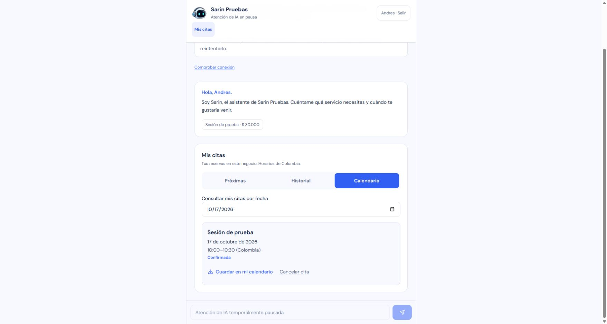

# Migración de datos a Cloudflare — 16 de octubre de 2026

Estado: datos y aplicación activados en Cloudflare, con aceptación de sesión, administración y citas existentes. La prueba final de Ollama queda pendiente porque el Mac está apagado.

El propietario autorizó mover datos comerciales a Cloudflare, conservar Firebase solo para autenticación Google y ampliar Wrangler con D1/R2, sin cambiar el plan contratado. Origen canónico: `https://sarinbotsaas.pages.dev`.

## Implementación y verificación local

- Next conserva la lógica comercial y utiliza una interfaz documental propia. El contenedor único accede a D1/R2 mediante el host virtual privado `sarin-data.internal`; no se publica una API de almacenamiento.
- D1 usa revisión global, commits CAS atómicos y journal de idempotencia. Las pruebas incluyen reservas concurrentes, última unidad de cuota, reintento de aprobación y contabilidad de IA.
- R2 conserva comprobantes privados e inmutables por SHA-256; las consultas no descargan imágenes. El bucket tiene el acceso `r2.dev` deshabilitado.
- Firebase cliente utiliza únicamente Auth. Las vistas consultan APIs autorizadas, refrescan cada 15 segundos después de terminar la lectura y suspenden el refresco cuando la pestaña está oculta. El cambio de UID/negocio invalida respuestas anteriores.
- Vault permanece exclusivamente en IndexedDB del navegador. No se exportaron conversaciones.

| Comprobación | Resultado |
| --- | --- |
| Aplicación, suite completa | 675 pruebas pasan; 20 integraciones omitidas por ese comando |
| Dominios reales sobre Workerd/D1/R2 local | 4 escenarios correctos, incluidos concurrencia y permisos |
| Importación/exportación | 18 pruebas correctas; hashes, tipos, aislamiento Windows, archivos y salida real de Wrangler verificados |
| Worker | 67 pruebas correctas, TypeScript y dry-run correctos |
| Gateway Pages | Sin cambios; 25 pruebas de la fase anterior |
| Tipos y build Next | Correctos |
| Build Pages | Correcto; 41 archivos públicos y gateway |
| Imagen Linux | Construida y publicada, plataforma `linux/amd64` |
| Revisión independiente | Dos hallazgos P1 resueltos y revisados: compatibilidad exacta del importador y `readTime` del servidor |

Imagen preparada: `registry.cloudflare.com/05fb22c155667de064b55c4e287b21d8/sarin-bot-data@sha256:2bd1c2d86293455a15f563dc08aae9b663d0636322d5370ce7eea957ef302601`. No se cambiaron dependencias ni el lockfile compartido.

## Recursos y corte

- D1 `sarin-bot-data`, UUID `b0cc530c-fce3-4758-a945-3e111091e09b`; esquema `0001_data.sql` aplicado sobre destino dedicado vacío.
- R2 `sarin-bot-files`, privado, clase Standard. El preflight encontró 19 documentos compatibles y cero archivos.
- Se conservó fuera de Git una copia del checkout previo y la configuración/despliegues activos del Worker. Los 13 secretos existentes se conservaron.
- Mantenimiento publicado inicialmente en `229b6ff2-76d4-492a-a643-ea7f6c47fcc3`; comprobación de drenaje saneada en `52fa680d-0429-423a-b707-a43db4eb0264`, sin cambiar la imagen anterior.
- A las 11:07 UTC se observó en la instancia activa y autenticada: `activeSlots=0`, `queuedRequests=0`, `criticalQueued=0`, `normalQueued=0`, `maxSlots=4`. Después se detuvieron las consultas del navegador. Las entradas y disparadores de fondo permanecieron bloqueados.
- Cloudflare dejó de asignar la instancia a las 11:08:50 UTC: estado `inactive`, sin ubicación ni versión asignadas. El CLI distingue este estado por la ausencia de una instancia subyacente; no quedó un contenedor ejecutando el proceso antiguo.
- Una revisión independiente de la API a las 11:11:43.708 UTC confirmó `instances=[]`, cero procesos ejecutándose y una sola página sin continuación. El checkpoint saneado está en `final-20261016T110920/old-instance-absence-reviewed.json` fuera de Git.
- Copia final: `final-20261016T110920`, `readTime=2026-10-16T11:09:24.856755Z`, 19 documentos / 10 colecciones / 0 ancestros faltantes. SHA-256 original `9ef81476bb82b22304abf2c18294e1726b0204afad14e28a8a650d21da64d787`; manifiesto preparado `d483c7bcd0a4558a58c0a0c0c2832fa7d2b65cb5df09b528458ab9c75e7d4d2f`. Todas las rutas y valores compatibles; cero archivos y cero reservas pendientes.
- El primer intento de importación se detuvo antes de escribir: Wrangler con `WRANGLER_LOG=error` devolvía stdout vacío incluso con `--json`. Se verificó de nuevo el destino vacío antes de corregir la captura del CLI.
- Con la captura corregida y su regresión real aprobada, `import-verified` y un segundo `verify-target` pasaron con los 19 documentos y el mismo hash de manifiesto. D1 mantuvo revisión 0 y journal vacío al terminar; tamaño observado 94.208 bytes. R2 contiene el manifiesto privado del traslado y queda preparado para comprobantes futuros.
- La imagen nueva se publicó con mantenimiento en la versión Worker `4e62cb99-095c-4eb5-8810-5392ff3b0938`; mantenimiento se retiró en `17d0d7e0-fc9a-4fc9-a18f-207faed9563f`. La configuración fuente y la publicada indican `SARIN_DATA_BACKEND=d1` y `SARIN_MAINTENANCE=false`.
- La revisión independiente de las 11:13:25.100 UTC confirmó la imagen exacta, aplicación versión 2, una instancia real `running`, su conexión al singleton y ausencia de otras instancias/páginas. Los 13 secretos se conservaron. Checkpoint privado: `final-20261016T110920/active-data-artifact-reviewed.json`.
- Después de aceptar datos y vistas se retiró exclusivamente el binding incondicional `roles/datastore.user` de la cuenta dedicada `sarin-runtime@sarinbotsaas.iam.gserviceaccount.com`, conservando `roles/firebaseauth.viewer` y WIF. La copia previa de políticas está en `iam-before-firestore-retirement-2026-10-16T11-16-24-707Z-bc8ce0ed` dentro del directorio privado de migración. El runtime anterior de la VPS comparte esa cuenta: una recuperación Firestore requiere restituir el permiso mínimo y reconciliar datos antes de reabrir.
- La verificación IAM independiente de las 11:17:44 UTC confirmó un único rol directo `roles/firebaseauth.viewer`, sin condición, y la política WIF idéntica, con sus dos sujetos. Checkpoint posterior: `iam-after-firestore-retirement-2026-10-16T11-17-39-850Z-8dc69209`. Tras retirar el permiso se recargó el cliente: sesión, negocio y citas volvieron a 200 y la cita confirmada seguía visible.

## Aceptación externa posterior al corte

| Comprobación | Resultado observado |
| --- | --- |
| Landing | 200, `no-store`, sin «Próximamente» |
| Sesión Google existente | `/api/session` 200; dashboard y navegación de administrador visibles |
| Administración | `/api/admin`, `/api/admin/ai`, `/api/admin/ai/usage` y `/api/admin/whatsapp` 200; configuración y negocio conservados |
| Negocio público | API nueva 200 con proyección pública; carga del negocio existente correcta |
| Mis citas | API autenticada 200 y cita confirmada del 17 de octubre de 2026, 10:00–10:30 Colombia, conservada |
| Historial | Vacío para esta cuenta, mensaje correspondiente visible |
| Calendario | Selección del 17 de octubre muestra la misma cita confirmada |
| Descarga `.ics` nueva | 360 bytes; un VEVENT; inicio `20261017T150000Z`, fin `20261017T153000Z`; archivo descargado a las 11:13:47 UTC |
| Acceso anónimo | Sesión, administración y citas privadas rechazan con 401; negocio público conserva su lectura pública explícita |
| Navegador | Lecturas por APIs; cero respuestas de `firestore.googleapis.com` en la ventana observada del cliente |
| Ollama | 503/offline esperado; Mac apagado y proveedor sin cambios |

La cuenta Google existente conserva su acceso administrador y su cita como cliente. No se utilizó otra cuenta real para repetir las pruebas de roles; los límites entre negocios/usuarios y las carreras se verificaron con datos sintéticos en las suites. No se aprobó ningún pago ni se creó/canceló una reserva real para acreditar la migración. El archivo `.ics` no se importó a una cuenta de calendario.

## Estado del motor

Cloudflare mostró el túnel directo del Mac en estado `Down`, sin réplicas, a las 11:03:44 UTC. El propietario confirmó que no puede encender el Mac en este momento. La salud de Ollama está offline; su aceptación final queda pendiente de encender el Mac y ejecutar Ollama/cloudflared. La respuesta de drenaje HTTP 200 con `online:false` acredita los contadores, no disponibilidad del modelo.

## Respaldo y reversión

Las copias están fuera de Git bajo `%LOCALAPPDATA%/SarinBot/data-migration-2026-10-16/`, con ACL restringida al usuario y SYSTEM. No se borró Firestore. El procedimiento de importación y reversión está en [el runbook de datos](../cloudflare-data-migration.md).

Después de cualquier escritura en D1 está prohibido volver solo el flag a Firestore: bloquear, drenar y detener; exportar D1/R2; generar y revisar el plan de reconciliación contra la copia final y verificarlo antes de reabrir. La instancia antigua de la VPS permanece retirada según [la migración de alojamiento](2026-10-16-cloudflare-migration.md).

No se crearon citas, pagos, mensajes ni inferencias de producción para esta migración. La prueba de escrituras comerciales completas, alertas de gasto y otros pendientes de apertura siguen registrados en la auditoría de producción. USD 15 es el presupuesto objetivo, no un límite automático. No hubo commit ni push del checkout mixto.
