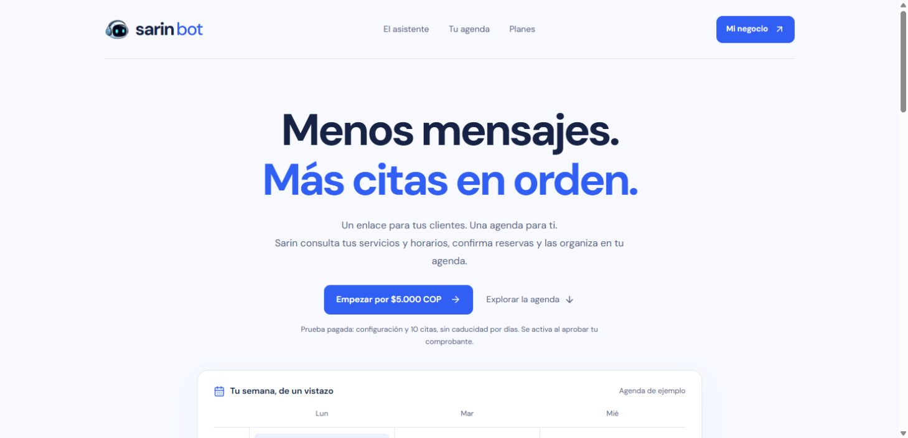
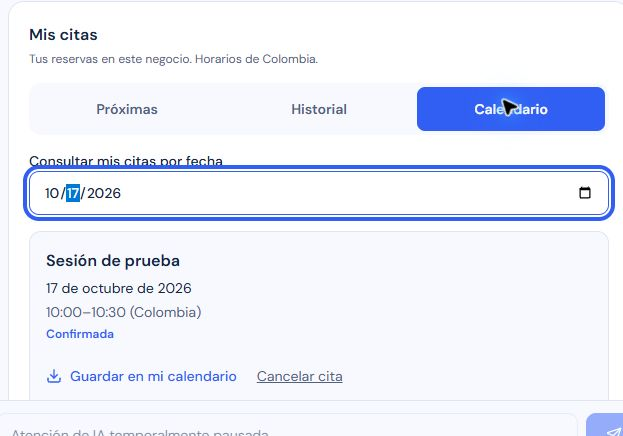

# Migración Cloudflare — infraestructura operativa

Estado: **publicado y verificado con sesión real; runtime Sarin de la VPS detenido**. El propietario autorizó migrar sin VPS, usar `https://sarinbotsaas.pages.dev` y renovar los permisos de Wrangler. Presupuesto indicado: hasta USD 15 mensuales para Sarin. La infraestructura activa de Sarin ya no depende de la VPS. La apertura comercial conserva los pendientes de la [auditoría de preparación](2026-10-16-production-readiness.md).

## Cambios publicados

- Pages producción: `054fe0f0-5b12-42fb-84c7-e7b193118401`. Su configuración real contiene `SARIN_APP_HOST → sarin-bot-app`; el build pasó a `pnpm run build:pages`, salida `landing/out`.
- Worker privado `sarin-bot-app`: publicación inicial `141cb9ba-d7ff-49d5-9d75-4a9f094cc912`, seguida de la carga de trece secretos de runtime. Sin hostname público propio, previews, logs de aplicación ni trazas.
- Container `sarin-bot-app-sarinapp`, ID `a032778c-ce3d-4673-b65a-4bf13fa3e02c`, imagen `sha256:02139a229a44638339fc0e28dd96097a34df696b4574b28436d145912bc45164`. Una instancia `basic`, nombre `sarin-global-app`, suspensión por inactividad de dos minutos. WhatsApp y retención permanecen deshabilitados.
- Firebase Auth y Firestore se conservan en Google. Se añadió `sarinbotsaas.pages.dev` a los dominios autorizados, preservando los tres existentes.
- Google WIF: pool `sarin-cloudflare`, proveedor `worker-oidc`, issuer canónico de Pages y sujeto `sarin-cloudflare-production`. `roles/iam.workloadIdentityUser` se concedió solamente a ese sujeto sobre la cuenta `sarin-runtime@sarinbotsaas.iam.gserviceaccount.com`. La confianza anterior de la VPS sigue presente.
- El plan WIF posterior a la aplicación devuelve `already-configured`, sin bloqueantes ni cambios. Los comandos fijan tanto proyecto como billing project: el proyecto predeterminado del operador era otro y provocó un 403 inicialmente; el permiso de IAM sí existía. No se añadieron roles al operador para resolverlo.

Los secretos se transfirieron desde el runtime existente mediante una lista explícita, sin imprimir valores ni copiar credenciales Google de la VPS. Tras subir los trece secretos se eliminó únicamente la exportación temporal `runtime-secrets.json`, fuera de Git; los originales y los secretos de Cloudflare se conservan. El modelo de visión no estaba configurado y continúa opcional. El contenedor crea su archivo ADC temporal de modo `0600`, directorio `0700`, bajo UID 1000; no contiene tokens ni claves Google.

## Evidencia local

| Comprobación | Resultado |
| --- | --- |
| Aplicación, `pnpm test` | 628 pasan; 20 integraciones omitidas por ese comando |
| GoogleAuth instalado, transporte sintético | Intercambio fuente → STS → IAM, caché, renovación concurrente y fallos controlados correctos |
| Cloudflare | 40 pruebas correctas, tipos y dry-run correctos |
| Gateway Pages | 25 pruebas correctas |
| TypeScript de la aplicación | Correcto |
| Imagen Linux Node 24 | Construcción completa y arranque correctos |
| Imagen local con límite de 1 GiB / 0,25 CPU | Portada y dashboard 200, sesión anónima 401; memoria observada en reposo ~99 MiB |
| Catálogo Ollama desde Docker local por HTTPS/Access | 200; modelo principal disponible; visión sin configurar |
| Build Pages | Exportación verificada y gateway empaquetado correctamente |

Las pruebas de emulador y la UI de cliente de la [auditoría anterior](2026-10-16-production-readiness.md) no se presentan como nuevas pruebas contra producción. No se generaron reservas, pagos, mensajes ni inferencias de producción durante esta fase.

## Evidencia externa

| Comprobación | Resultado observado |
| --- | --- |
| Discovery y JWKS en el origen canónico | 200, `no-store`, dos claves públicas ES256, sin campos privados |
| Landing | 200, `no-store`, sin «Próximamente»; planes y enlaces de aplicación presentes |
| `/api/session` sin sesión | 401 JSON, `no-store` |
| Suspensión del Container | API Containers mostró `inactive` y después `stopped`, sin otros runtimes ni réplicas nuevas |
| Nueva llamada anónima a `/api/businesses` | 401 tras despertar; aproximadamente 3,0 segundos |
| Configuración real de Pages y Google | Binding y build confirmados; proveedor activo y grant exacto confirmados |
| Inicio de sesión Google en Chrome | El propietario completó Google; dashboard autenticado y acceso de administrador visibles |
| `/api/session` autenticada | 200; esta ruta verifica el token con Firebase Admin y lee el documento del usuario en Firestore desde el Container |
| Administración autenticada | `/api/admin`, `/api/admin/ai`, `/api/admin/ai/usage` y `/api/admin/whatsapp`: 200, sin copiar sus datos privados |
| Ollama desde Cloudflare | `/api/sarin/health?scope=vault`: 200, `provider: ollama`, `online: true`, `visionAvailable: false` |
| Recuperación real después de suspensión | Dashboard/sesión y salud de Ollama vuelven a 200 después de observar el Container detenido; nuevas credenciales Google adquiridas correctamente |
| Repetición sin el Node de la VPS | Sesión, APIs administrativas y salud Ollama: 200 después de detener el contenedor antiguo |
| Ruta directa a la Mac | Tunnel `sarin-mac-ollama` Healthy, dos réplicas `MacBook-Pro-de-Luis.local`, `darwin_arm64`; `ia-sarin.alsdevstudio.com`, patrón `^/v1/(chat/completions|models)$`, hacia `http://127.0.0.1:11434` |
| Cliente en el negocio de pruebas existente | Próximas, Historial y Calendario por fecha funcionan con sesión real; reserva confirmada del 17 de octubre, 10:00–10:30 Colombia |
| Descarga real de calendario | Archivo `.ics` de 360 bytes, un VEVENT, `20261017T150000Z`–`20261017T153000Z` |
| Diagnóstico por SSH de Container | No ejecutado: el CLI devolvió `INSTANCE_NOT_READY`. No se configuraron claves SSH ni se habilitaron accesos adicionales |

El historial está vacío para esta cuenta y lo indica correctamente. El aviso de IA pausada corresponde al acceso comercial del negocio de prueba: sus citas siguen accesibles. La automatización del evento de descarga agotó la espera, pero el archivo sí se descargó y se verificó desde el disco. No se importó a ninguna cuenta de calendario. No se ejecutó un `GET /api/businesses` autenticado directamente: la evidencia servidor de Auth/Firestore procede de sesión y administración, no solo del SDK cliente.

## Retirada del runtime anterior y reversión

- Se verificó y detuvo únicamente el contenedor Docker `/sarin-bot-app-1`, proyecto Compose `sarin-bot`, servicio `app`, imagen `sha256:67816e580e223d095e9523491120c3e092fa62b70682339706fc0d7569c592e3`. Estado final `exited`, código 143 por SIGTERM. Se conservaron imagen, configuración y archivos.
- Se deshabilitó y detuvo `sarin-x509-rotate.timer`, tras confirmar que su único destino es la renovación de certificados de Sarin en `/opt/sarin-bot/identity/sarin-x509-rotate.sh`. Estado final `inactive`, `disabled`; servicio y archivos conservados.
- Se detuvo exclusivamente el proceso SSH del antiguo forward `127.0.0.1:3032 → 127.0.0.1:3000`. Su checkpoint quedó en `%LOCALAPPDATA%/SarinBot/cloudflare-migration-2026-10-16/legacy-forward-before-stop.json`.
- No se apagó ni borró la VPS ni se tocaron otros servicios. La confianza Google anterior se retiene para reversión; la identidad activa de Cloudflare no usa sus certificados.

Para revertir después de un período detenido, renovar primero el certificado con el servicio dedicado, reactivar su timer y arrancar el contenedor conservado antes de restituir el tráfico. Evitar dos colas de inferencia simultáneas. Procedimiento completo en el [runbook](../cloudflare-no-vps-runbook.md).

## Pendientes para la apertura comercial

1. Completar el recorrido público de escritura con cuentas de aceptación: inferencia, nueva reserva, cancelación y conciliación de pago. Esta fase comprobó una reserva existente, historial, consulta por fecha y descarga; no creó/canceló citas ni generó pagos, mensajes o inferencias de producción. El recorrido de escritura de 96 comprobaciones del emulador es evidencia distinta.
2. Cerrar límites contra abuso, información de privacidad, restauración de datos, alertas y responsabilidad de pagos descritos en la auditoría comercial.
3. Observar la expiración natural del token Google de una hora dentro del mismo proceso. La renovación sintética pasa y la adquisición real después de reiniciar fue comprobada; no se presenta como observación de una hora continua.
4. Configurar alertas de gasto e integrar en Git las fuentes exactas publicadas. USD 15 es presupuesto, no un corte automático.

Vault continúa en IndexedDB por navegador, UID y origen. No se transfirió entre `localhost` y Pages: la bóveda del origen público es independiente. No se copiaron conversaciones a Cloudflare.

## Costos y recuperación

Workers Paid ya estaba activo; no se contrató un plan adicional ni se cambió facturación. La estimación conservadora de una instancia básica durante 30 días completos es USD 11,93 incluyendo la base de USD 5, antes de CPU y otros consumos. Dormir reduce uso; **no existe un corte automático de USD 15**. Las alertas de gasto de Sarin siguen pendientes. Ver [cálculo y operación](../cloudflare-no-vps-runbook.md#presupuesto-operativo).

El respaldo previo completo de Pages está fuera de Git, en `%LOCALAPPDATA%/SarinBot/deployment/cloudflare-pages-sarinbotsaas-before-binding-20261016T094526682Z.json`, SHA256 `2C48864D662D7B13EB3D4A42A2D1CAD3625D4F6CC7273C8E7A8A6654B9B52433`. Incluye el despliegue anterior `3cd9bd91-bd8f-44ea-be30-8f2005198a6b`. Los snapshots Google/Firebase y la configuración privada están fuera de Git en el directorio de revisión de esta migración.

No hubo commit ni push en este checkout mixto. La publicación se hizo del artefacto local revisado con `commit-dirty=true`; antes de futuras publicaciones Git se debe integrar y verificar el conjunto de cambios autorizado. No se debe describir el commit adjunto a Pages como una reproducción exacta de este artefacto.
