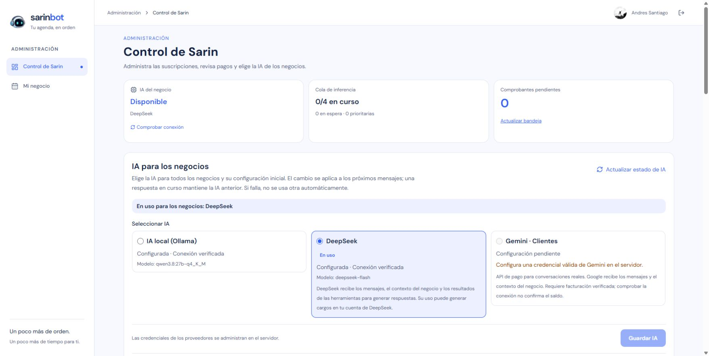

# Aceptación comercial: Ollama y DeepSeek

Actualización posterior del mismo día: la descarga ICS comprobada en esta fase fue sustituida por **Guardar imagen de la cita**. El [informe de imagen PNG](2026-10-16-appointment-image.md) documenta la versión publicada posterior y sus comprobaciones. Los resultados de reserva, cancelación y proveedor de este informe se conservan como evidencia de su fase.

Estado: aceptación funcional completada y nueva imagen publicada. Apto para iniciar un piloto comercial controlado del servicio de reservas por enlace, con DeepSeek activo por decisión del propietario. Este resultado no acredita capacidad masiva, un marketplace disponible ni conciliación bancaria real.

## Alcance y separación de datos

La aceptación usa `https://sarinbotsaas.pages.dev`, Cloudflare D1/R2 y la autenticación habitual de Google. El negocio sintético es **Sarin Aceptación QA**, slug `sarin-aceptacion-20261016`, ID `b_1d4a4ca1d86500f15c7f902081af472b`. Su descripción advierte que no ofrece atención real. El teléfono es de ficción. No se cancela ni modifica la cita preexistente del otro negocio.

La carga de pago usa una imagen rotulada **NO ES UN COMPROBANTE BANCARIO / Sin transferencia de dinero**. Comprueba carga, compresión, almacenamiento privado, revisión y activación; no acredita una transferencia ni ingresos reales. El registro debe conservarse identificado como aceptación técnica.

## Resultados observados en producción

El recorrido Ollama precede a esta publicación; el recorrido DeepSeek y su cancelación se ejecutaron sobre la imagen final descrita abajo.

| Paso | Resultado |
| --- | --- |
| Comprobante de prueba pagada | Imagen PNG seleccionada por navegador, comprimida a WebP de aproximadamente 23 KB; envío recibido como pendiente. |
| Revisión administrativa | La imagen se recuperó mediante acceso privado; el botón de aprobación se habilitó después de verla. Aprobación confirmada; 10 citas y 700 respuestas activadas en el negocio de aceptación. |
| Ollama: configuración del negocio | Solicitud pública `/api/sarin/chat` con HTTP 200; aproximadamente **70,2 s** hasta recibir cabeceras. Herramienta de configuración guardó los datos del negocio. |
| Persistencia independiente | GET público del negocio devolvió HTTP 200 con recurso `profesional-qa`, servicio `corte-prueba`, 30 minutos, margen posterior 10 minutos, 30.000 COP; lunes a sábado 09:00–12:00 y domingo cerrado. |
| QR canónico | Descargado `sarin-qr-sarin-aceptacion-20261016.svg`, 4.206 bytes. Sus trazados coinciden con la codificación de la URL canónica usando el mismo nivel y margen configurados. El evento de descarga del harness agotó la espera, pero el archivo existe y se comprobó desde disco. |
| Acceso cliente distinto | Cambio normal de Google iniciado; su selector quedó en «Cargando» bajo automatización. Se pidió completar manualmente el acceso. No se usaron tokens personalizados ni se impersonó un UID. |
| Acceso cliente completado | El operador completó el acceso. `/api/session` devolvió 200, cuenta cliente esperada y `isSuperadmin: false`. |
| Ollama: disponibilidad | HTTP 200, aproximadamente **25,5 s**. Consultó disponibilidad y mostró servicio/precio/horario; no creó una cita al pedir explícitamente revisar antes de confirmar. |
| Ollama: reserva | Después de la confirmación explícita: HTTP 200, aproximadamente **20,2 s**, herramienta `crear_cita`, cita `f18f04106939220bc8c4dbde8e93dc6d5acc608e0a5e62e40e583448a2991974`, 17 de octubre 09:00–09:30 Colombia. Apareció en próximas citas y en calendario al seleccionar el día 17. |
| Ollama: archivo de calendario | Descargado y validado desde disco: 365 bytes, `DTSTART:20261017T140000Z`, `DTEND:20261017T143000Z`, servicio correcto. |
| Ollama: cancelación e histórico | El primer botón mostró confirmación manteniendo la cita confirmada. Tras «Sí, cancelar cita», respuesta 200 y registro en historial como «Cancelada por ti». No se modificó la cita del otro negocio. |
| DeepSeek: configuración | Proveedor seleccionado y guardado en administración. Primero mostró un resumen (HTTP 200, **3,54 s**); tras confirmarlo, ejecutó `guardar_estructura_negocio` con resultado guardado (HTTP 200, **5,72 s**), conservando la prueba y su cita ya utilizada. |
| DeepSeek: disponibilidad | HTTP 200, **4,35 s**; consultó el mismo horario de 09:00, ya liberado por la cancelación anterior. Explicó correctamente servicio 09:00–09:30 y margen ocupado hasta 09:40, y esperó confirmación. |
| DeepSeek: reserva | HTTP 200, **4,58 s**; `crear_cita` produjo la cita `7e313441a041bf7bcd9f8c20a407483427441dd43caa6f80156a66fbdaf8c2d0`, 17 de octubre 09:00–09:30. Apareció en próximas citas. |
| DeepSeek: calendario externo | Archivo `.ics` real descargado y comprobado desde disco: 365 bytes, inicio `20261017T140000Z`, fin `20261017T143000Z` y servicio correcto. |
| DeepSeek: agenda del propietario | La cita confirmada apareció el día 17, junto a la cancelación de Ollama; la prueba mostró 2 de 10 citas utilizadas y 8 disponibles. |
| DeepSeek: cancelación e histórico | Primer clic abrió confirmación. Al confirmar, la API devolvió 200 y la reserva pasó al histórico. La etiqueta fue «Cancelada por el negocio» porque esta corrida usó el UID del propietario en la pantalla cliente; no se presenta como una cancelación hecha por otro cliente. |
| DeepSeek: calendario por fecha | Al seleccionar 17 de octubre, mostró la cita cancelada, sin acciones de reserva confirmada. La agenda administrativa se actualizó a 0 confirmadas, una cancelada por cliente y otra por negocio. |
| Limpieza del negocio sintético | Los siete días se guardaron cerrados mediante el formulario normal. Una lectura pública independiente confirmó `isOpen:false` e intervalos vacíos en todos los días. Se conservaron el histórico y el comprobante de ensayo; no se borraron documentos directamente. |

La aceptación de Ollama se realizó con una cuenta cliente distinta del propietario. Para DeepSeek, después de la configuración se usó la sesión del propietario en la pantalla cliente del mismo negocio: «Mis citas» no mostró la cita cancelada de la otra cuenta. Esta comprobación valida la operación de cliente en esa sesión, sin presentarla como otra corrida con cuenta externa distinta.

La salida de la configuración de Ollama mostró Markdown como texto literal. El guardado está verificado por separado; la presentación necesita considerarse en la revisión de interfaz.

## Cambios publicados

- Límite persistido por cliente: 10 admisiones/60 segundos, 60/hora y 120/24 horas. Los reintentos que pueden volver a llamar al proveedor también cuentan; las recuperaciones de solicitudes completadas o reservadas siguen el contrato de cuota. Sin cuerpos ni IP en el registro.
- Páginas públicas de ayuda y datos, con `alsdevstudio@alsdevstudio.com` y Andrés Santiago como contacto confirmado.
- Corrección de textos que llamaban privado al perfil público o anunciaban un copiloto sin pantalla disponible.
- Los comprobantes se revisan **solo en la bandeja administrativa**, por elección expresa del operador. No se activaron correos por cada comprobante.

Validación previa al despliegue: 679 pruebas de aplicación correctas, 20 omitidas; 68 pruebas de Cloudflare, tipos y dry-run correctos; 25 pruebas de gateway correctas; builds de aplicación y landing correctos; validación de landing correcta. La auditoría independiente de dependencias no encontró vulnerabilidades conocidas.

Imagen preparada, subida al registro y **activada en producción**:

`registry.cloudflare.com/05fb22c155667de064b55c4e287b21d8/sarin-bot-opening@sha256:3c416933dbc6ec618e71fd6d6199ae162a17889fb87ea24f58aab3c89ef44c01`

Se construyó para `linux/amd64` con el lockfile compartido y únicamente los cuatro argumentos públicos de Firebase. La copia privada de fuentes de esta preparación está en `%LOCALAPPDATA%/SarinBot/commercial-acceptance-2026-10-16/source-opening-20261016T070254375`, con 123 archivos y manifiesto SHA-256 `336caf7932b7e764ba9ece6f596696a142069df8c3113aef18e078dbf3c81b68`. No se hizo commit masivo de los cambios previos del checkout.

La reversión técnica prevista mantiene D1 y vuelve a la imagen comercial anterior `cfc7c32d2dfc3815781b5187e3c86c09e739e519e0b0cb55e1055a9673c3cd46`. Los documentos nuevos del limitador son aditivos y pueden conservarse al revertir la aplicación. No se debe volver a Firestore cambiando solo una variable: las escrituras posteriores al corte requieren reconciliación e IAM según el runbook.

La consola mostró 0/4 inferencias y 0 en espera antes de cerrar el ingreso. El Worker de mantenimiento `b706b4a6-3674-4c6e-b640-6679a304602d` devolvió 503 en el acceso público. La consulta ordinaria de salud del panel quedó bloqueada por ese mantenimiento, porque no usa el scope técnico `engine`; no se interpreta como una lectura válida de cola posterior al cierre. Un diagnóstico técnico transitorio devolvió disponibilidad temporal mientras arrancaba el contenedor nuevo; se retiró la interceptación de prueba inmediatamente.

El despliegue bajo mantenimiento fue `e9d2815d-57b0-4b86-afcc-e65ad541eb39`; se verificó versión 4 con la imagen nueva y cero instancias antiguas antes de reabrir. Worker final: **`5beb7020-fb82-42b7-a618-ea0406e5803a`**. Comprobación independiente a las **12:12:27 UTC**: D1, mantenimiento desactivado, 13 secretos preservados, una instancia running de la imagen nueva y ningún registro antiguo, con paginación completa.

Después de reabrir: `/`, `/privacidad`, `/ayuda` y el negocio público devolvieron 200; `/api/session` sin credencial devolvió 401. La configuración y las dos operaciones de DeepSeek descritas arriba se ejecutaron sobre esta imagen. Se volvió a ejecutar el verificador de recuperación local a las **12:13:37 UTC**, con esquema, filas y R2 correctos.

## Controles de gasto

Se guardaron y verificaron las alertas nativas de Cloudflare de USD 5 y USD 8, activas por correo al destinatario ya configurado de la cuenta. DeepSeek quedó con aviso de saldo USD 2 activado y CNY desactivado. No son topes automáticos ni acreditan entrega de correo; ver [evidencia de gasto](2026-10-16-spending-controls.md).

El operador eligió expresamente **dejar DeepSeek atendiendo a los clientes** después de las pruebas. Ollama queda como opción manual; no hay sustitución automática si falla un proveedor.

## Estado final y límites de la apertura

La consola final mostró **DeepSeek disponible y en uso**, modelo `deepseek-flash`, cola **0/4** y **0 en espera**. El medidor registró **7 llamadas correctas, 0 fallidas, 17.633 tokens de entrada y 1.784 de salida**, con 13.824 tokens de entrada en caché. El rango estimado del uso registrado fue **USD 0,0017–0,0034**, según las tarifas versionadas del medidor; no es una factura ni una garantía de cobertura total. El negocio conservó 7 de 700 respuestas utilizadas y 2 de 10 citas utilizadas; cancelar no devuelve citas a la prueba.

Comprobación independiente final a las **12:19:36 UTC**: D1, mantenimiento desactivado, 13 secretos preservados, versión 4, una instancia actual en ejecución y cero registros antiguos; paginación completa. El humo HTTP final verificó `/`, `/ayuda` y `/privacidad` con 200, portada sin «Próximamente», `/admin/vault` con 404 y `/api/session` anónima con 401.

Una lectura independiente de agregados D1 a las **12:21:31 UTC** confirmó que el negocio original conserva su cita **confirmada del 17 de octubre, 10:00–10:30**. El negocio QA conserva exactamente dos canceladas, cero confirmadas y siete días cerrados. No se recuperaron cuerpos de documentos ni contactos para esa comprobación. Los procesos locales de Next y emuladores usados en esta corrida se detuvieron al terminar; sus puertos 3041, 9099, 8080 y 4400 quedaron sin listeners.

Ayuda y privacidad se revisaron también en el entorno aislado a 320 px, sin desbordamiento horizontal. El [ensayo de restauración D1/R2](2026-10-16-d1-recovery-drill.md) terminó; esta copia precede a las citas nuevas de aceptación y no debe confundirse con una copia posterior a todas las pruebas.

El piloto puede ofrecer configuración, enlace/QR, reservas, agenda, historial y cancelación con revisión manual de comprobantes. Antes de una campaña amplia quedan decisiones y validaciones concretas:

- Realizar y conciliar una transferencia auténtica si se quiere acreditar también el circuito bancario; el ensayo técnico no movió dinero.
- Formalizar los plazos de conservación y las condiciones de devolución del servicio; los textos publicados explican la operación actual sin inventar esos plazos.
- Medir uso y latencia con clientes iniciales. La instancia única y los límites de solicitudes no equivalen a capacidad masiva ni a un tope monetario; los avisos no garantizan USD 15 máximos.
- Definir y aplicar un máximo de citas futuras activas por cliente antes de abrir captación amplia. El limitador actual acota inferencias por UID; no verifica titularidad del teléfono ni evita reservas abusivas distribuidas entre varias cuentas.
- Integrar deliberadamente las fuentes revisadas en Git y ejecutar el CI correspondiente. Se conservó una copia privada reproducible de las fuentes publicadas; no se hizo un commit masivo del checkout con cambios anteriores.
- Mantener WhatsApp sin ofrecer como activo hasta conectar y comprobar un número real. El marketplace requiere una implementación posterior.

Precisión editorial para la siguiente revisión del aviso: «historial de estados» se refiere al historial de citas y su estado actual; no existe un registro de auditoría de todas las transiciones de cada reserva. No debe ofrecerse esa auditoría como una función existente. Las respuestas del chat también pueden mostrar marcas Markdown literales; es una mejora visual pendiente que no altera los datos de la reserva comprobada.

El recorrido local completo también pasó sus 96 comprobaciones. La primera corrida se ejecutó por error en paralelo con el smoke, que actualiza el mismo perfil sembrado del administrador; el journey detectó ese cambio concurrente. Identificada esa causa, se ejecutó por separado y pasó con limpieza completa de sus datos sintéticos. No se modificó el código para esconder el fallo.

El [análisis de Fresha](2026-10-16-fresha-analysis.md) es una propuesta de evolución de producto; no se presenta como un marketplace ya implementado.
