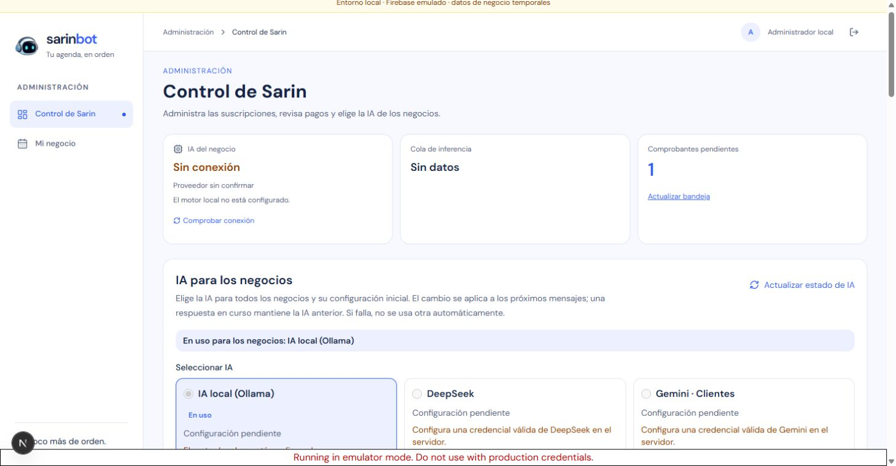
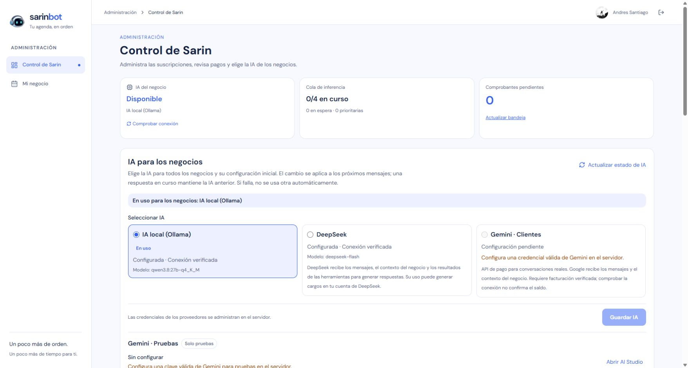

# Retiro de Vault y foco comercial — 16 de octubre de 2026

Estado: retiro publicado y aceptado en el origen público; sesión, panel comercial y cita existente verificados.

El propietario pidió retirar Vault y descartar el proyecto de chat personal para concentrar Sarin en negocios, citas, clientes, pagos y suscripciones. Se conserva la infraestructura comercial D1/R2/Firebase Auth, el motor de IA y una sola cola de inferencia. No se construyó el chat independiente ni se configuró Tailscale para él.

## Cambios

- Retiradas la pantalla `/admin/vault`, su API `/api/sarin/vault`, almacenamiento IndexedDB, esquemas, tipos, finanzas, importación/exportación y pruebas exclusivas del módulo.
- Retirados los accesos de la navegación, el botón administrativo y los textos que ofrecían Vault. El selector de IA y la consola de negocios siguen disponibles.
- Diagnóstico local administrativo renombrado a `/api/sarin/health?scope=engine`, conservando autorización superadmin, proveedor Ollama, caché independiente y saneamiento de errores. El alcance anterior se rechaza sin consultar el modelo.
- La excepción de lectura durante mantenimiento usa el mismo alcance nuevo. Conserva validación estricta de ruta/query/Bearer, verificación Next y respuesta de cola saneada cuando el motor está offline.
- Retiradas `react-markdown`, `remark-gfm` y `fake-indexeddb`; actualizado el único lockfile con pnpm 11.23.0. Se conservan compresión de comprobantes, generación `.ics`, proveedores comerciales y el contrato de cola.
- Guías actuales centradas en el producto comercial; los reportes y planes anteriores se conservan como evidencia histórica.

Este retiro no ejecuta una purga de datos personales en dispositivos. Las bases IndexedDB, descargas y copias de Vault que pudieran existir en navegadores anteriores no se inspeccionaron ni borraron. La copia privada de las fuentes retiradas contiene código y pruebas, no conversaciones.

## Verificación local

| Comprobación | Resultado |
| --- | --- |
| TDD de navegación y consola | Dos fallos esperados antes del retiro; 35 pruebas focales pasan después |
| TDD de salud y mantenimiento | Nuevos alcances fallan antes del cambio; pruebas de autorización y rechazo del alcance retirado pasan |
| Suite de aplicación | 659 pasan; 20 integraciones omitidas por ese comando |
| Worker | 68 pasan; tipos y dry-run correctos |
| Gateway | 23 pasan |
| TypeScript y build Next | Correctos; el manifiesto de rutas ya no incluye pantalla/API Vault |
| Dependencias | `pnpm audit --audit-level=high`: sin vulnerabilidades conocidas |
| Smoke contra emuladores oficiales | Auth, administración, facturación y negocio correctos; página/API retiradas 404, alcance anterior 400 y diagnóstico de motor para cliente 403 |
| Recorrido comercial real local | 96 comprobaciones: pago inicial, configuración, diez citas, concurrencia, idempotencia, cancelación, bloqueos y aprobación de pago; limpieza sintética confirmada |
| Chrome con cuenta de prueba local | Navegación administrativa solo «Control de Sarin» y «Mi negocio»; pantalla comercial y selector de IA disponibles, sin enlaces Vault |
| Revisión independiente | Sin hallazgos P1/P2; utilidades compartidas y fronteras de autorización conservadas |

Al retirar rutas, TypeScript detectó validadores Next antiguos que aún las referenciaban. Se conservaron fuera del proyecto los directorios generados de tipos y se regeneraron mediante build/dev; no se modificaron fuentes para ocultar el problema.

## Publicación y recuperación

Imagen preparada: `registry.cloudflare.com/05fb22c155667de064b55c4e287b21d8/sarin-bot-commercial@sha256:cfc7c32d2dfc3815781b5187e3c86c09e739e519e0b0cb55e1055a9673c3cd46`.

Imagen anterior de recuperación, también D1: `registry.cloudflare.com/05fb22c155667de064b55c4e287b21d8/sarin-bot-data@sha256:2bd1c2d86293455a15f563dc08aae9b663d0636322d5370ce7eea957ef302601`. No hay migración de esquema ni datos para este retiro. Cualquier recuperación debe mantener una sola instancia, D1 como fuente comercial y la configuración de Auth/Access; no volver al runtime Firestore de la VPS.

El checkpoint independiente previo confirmó `backend=d1`, mantenimiento desactivado, 13 secretos, aplicación versión 2 y una instancia con la imagen anterior. El mantenimiento se activó sin cambiar imagen con el Worker `4bbbbd6b-05fa-419c-99ff-bfc0190123bd`, conservando el diagnóstico de la versión anterior hasta drenar. La lectura autenticada posterior mostró `activeSlots=0`, `queuedRequests=0`, `criticalQueued=0`, `normalQueued=0`, `maxSlots=4`. En ese momento Ollama ya respondía `online:true`; se detuvo el sondeo del navegador para permitir la suspensión.

La suspensión automática no se confirmó antes de publicar: la instancia seguía activa en la revisión de las 11:40:52 UTC. Como no había trabajo en cola ni migración de datos y las entradas seguían bloqueadas, se utilizó el rollout normal de Cloudflare, sin forzar eliminación. El Worker `7b54e3be-5def-4b2e-9016-61a64bbbfe59` publicó la imagen nueva bajo mantenimiento. A las 11:42:16 UTC, la API confirmó aplicación versión 3, imagen nueva, una asignación inactiva y cero registros de la imagen anterior, con paginación completa. Se retiró mantenimiento en `0b3f3507-1080-402f-80aa-fb942d9b89bf`.

## Aceptación externa

- Landing 200; página `/admin/vault` y POST `/api/sarin/vault` devuelven 404. Sesión y administración anónimas conservan 401.
- Sesión Google existente 200. `/api/admin`, `/api/admin/ai`, `/api/admin/ai/usage` y `/api/admin/whatsapp` respondieron 200.
- Navegación administrativa: «Control de Sarin» y «Mi negocio», sin acceso a Vault. La pantalla conserva suscripciones, revisión de comprobantes y configuración comercial de IA.
- Salud comercial 200, `provider=ollama`, `online=true`, cuatro slots y cola vacía; no se generó una respuesta del modelo para esta comprobación.
- El negocio público y la API autenticada de citas respondieron 200. «Mis citas» conserva la reserva confirmada del 17 de octubre de 2026, 10:00–10:30 Colombia. No se crearon ni cancelaron reservas de producción.
- Checkpoint independiente de las 11:43:23 UTC: D1 activo, mantenimiento desactivado, 13 secretos, aplicación versión 3 y una instancia `running` con la imagen comercial nueva; cero registros de la imagen anterior, paginación completa.

Los emuladores y el servidor local de esta verificación se detuvieron al terminar; sus puertos dejaron de escuchar. No hubo cambios de plan, credenciales, túnel de Ollama, esquema ni datos comerciales de producción durante el retiro.

Fuentes retiradas, configuración e imagen previa conservadas fuera de Git bajo `%LOCALAPPDATA%/SarinBot/vault-retirement-2026-10-16/`. No hubo commit/push del checkout mixto.

## Pendientes comerciales conservados

Ollama volvió a responder con `online:true` durante el drenaje, después del estado offline documentado en la fase anterior. Consultar su catálogo no acredita una conversación completa ni ejecución de herramientas comerciales. La apertura comercial mantiene los pendientes de [la auditoría de producción](2026-10-16-production-readiness.md), incluidos aceptación pública completa de escritura e inferencia, privacidad, controles contra abuso y alertas de gasto. WhatsApp continúa deshabilitado y no existe un corte automático de USD 15.
