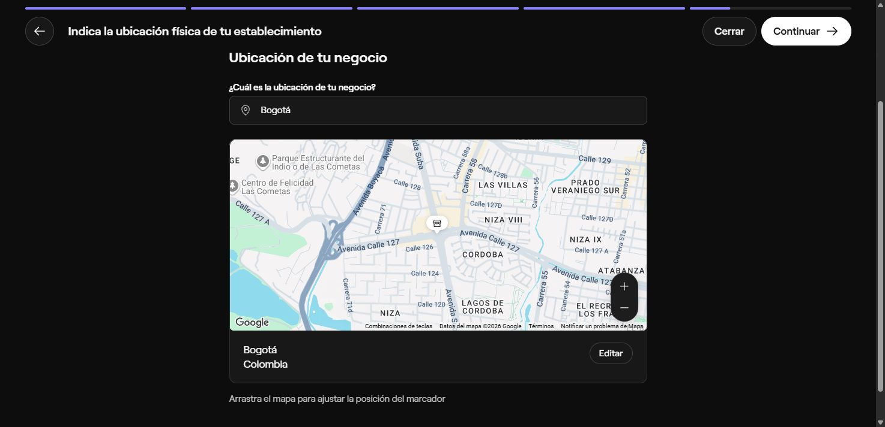

# Seguimiento del registro de Fresha

Revisión interactiva del 16 de octubre de 2026 sobre la pestaña que el propietario tenía abierta. Continúa el [análisis anterior](2026-10-16-fresha-analysis.md). El objetivo es documentar patrones para Sarin, no copiar datos de clientes ni completar un negocio en Fresha.

## Pantallas observadas

| Ruta bajo `partners.fresha.com/onboarding/` | Observación de interfaz | Adaptación propuesta |
| --- | --- | --- |
| `partner_business_name` | Progreso 20%, nombre comercial y web opcional; nombre preexistente «Barberia norte». | Explicar qué nombre verá el cliente y permitir editarlo después sin cambiar el QR. |
| `partner_service_types` | Progreso 40%, categoría principal y hasta tres relacionadas; Barbería ya seleccionada. | Categoría estructurada para la futura búsqueda; evitar un formulario inicial extenso. |
| `partner_team_size` | Progreso 60%, independiente, 2–5, 6–10, 11–20 y más de 20; independiente ya seleccionado. | Configurar un recurso inicial para independiente; no exigir contratar personal para completar el alta. |
| `partner_location_address` | Progreso 80%, atención presencial, a domicilio u online. Al seleccionar presencial, continuar lleva a una pantalla específica. | Mostrar dirección según modalidad; pedir ciudad/zona para domicilio y evitar publicar una dirección privada por defecto. |
| `partner_location_venue_address` | Progreso 85%, buscador de ubicación con sugerencias, mapa Google, marcador ajustable y acción Editar. | Dirección manual simple primero; mapa/autocompletado puede esperar hasta justificarlo por uso y costo. |
| `partner_location_venue_address/business-location` | Edición con dirección, piso/apto. (100 caracteres), distrito, ciudad, condado, región/provincia, código postal, país y direcciones/instrucciones (200 caracteres); Guardar y Cancelar. País Colombia aparecía no editable. | Para Colombia priorizar dirección, barrio, ciudad, departamento e indicaciones opcionales. No reproducir etiquetas internacionales poco naturales como Condado. |

Se consultó «Bogotá», una ubicación geográfica pública, para ver sugerencias y el mapa. El aviso de dirección inválida apareció durante la entrada y fue transitorio: después de elegir el resultado se mostró el mapa y el resumen de Bogotá. Esto no demuestra validación de calle/número ni prueba que Fresha rechace una ciudad como dirección final. Se abrió Editar para leer sus campos y se cerró con Cancelar, sin guardar el formulario manual ni continuar a finalizar el workspace.

La selección exploratoria dejó el borrador en la pantalla de ubicación; no se pulsó una acción final de alta/publicación, ni se aceptaron condiciones, contrataron servicios o hicieron reservas/pagos. No se inspeccionaron cookies, credenciales, tráfico privado ni bases de datos de Fresha. La extracción se limitó a estructura, etiquetas y navegación visibles.

## Recomendación para Sarin

Onboarding corto: acceso/prueba o invitación, identidad/modalidad, servicios/precios/duración, disponibilidad y revisión antes de obtener el QR. Guardar el borrador y permitir continuar después. El propietario puede configurar su negocio mediante formulario; la IA puede asistir sin ser requisito para completar campos básicos. La publicación en un directorio es una decisión posterior.

Fresha documenta por separado [crear un workspace](https://www.fresha.com/help-center/knowledge-base/workspace-settings/40-create-a-new-workspace) y [publicar un perfil online](https://www.fresha.com/help-center/knowledge-base/online-presence/266-create-your-online-profile). Las pantallas vistas y esas guías respaldan la separación; no se verificó un alta final, sus comisiones ni operaciones comerciales de una cuenta nueva en esta revisión.

## Comprobación pública de Sarin

Lectura anónima del 16 de octubre, 16:52:25 Colombia, mediante GET, sin inferencia ni mutaciones:

| Ruta en `https://sarinbotsaas.pages.dev` | HTTP | Caché |
| --- | ---: | --- |
| `/` | 200 | no-store |
| `/ayuda` | 200 | no-store |
| `/privacidad` | 200 | no-store |
| `/api/session` | 401 | no-store |

Confirma accesibilidad y rechazo anónimo de la API de sesión. No reemplaza el [recorrido comercial autenticado previo](2026-10-16-commercial-e2e.md) ni mide capacidad. El lector web remoto no pudo acceder al dominio; los resultados de la tabla proceden de solicitudes directas desde el entorno local.
