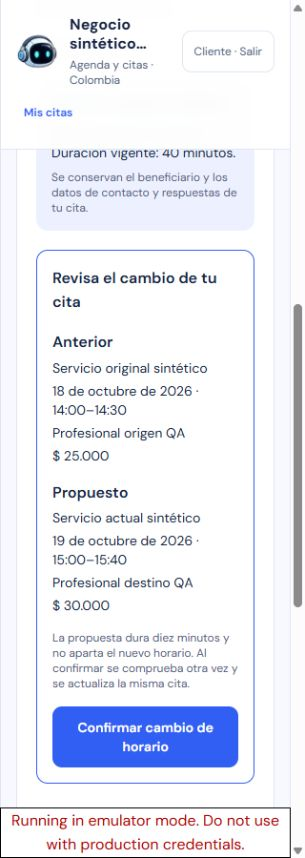
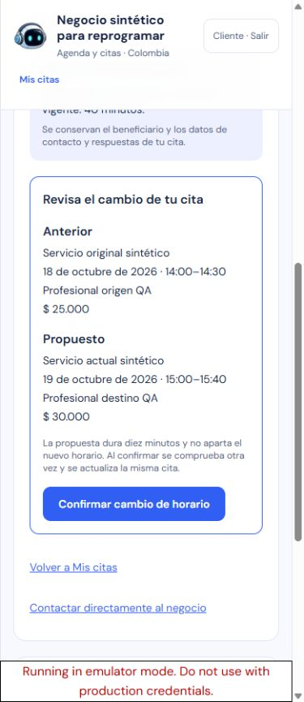
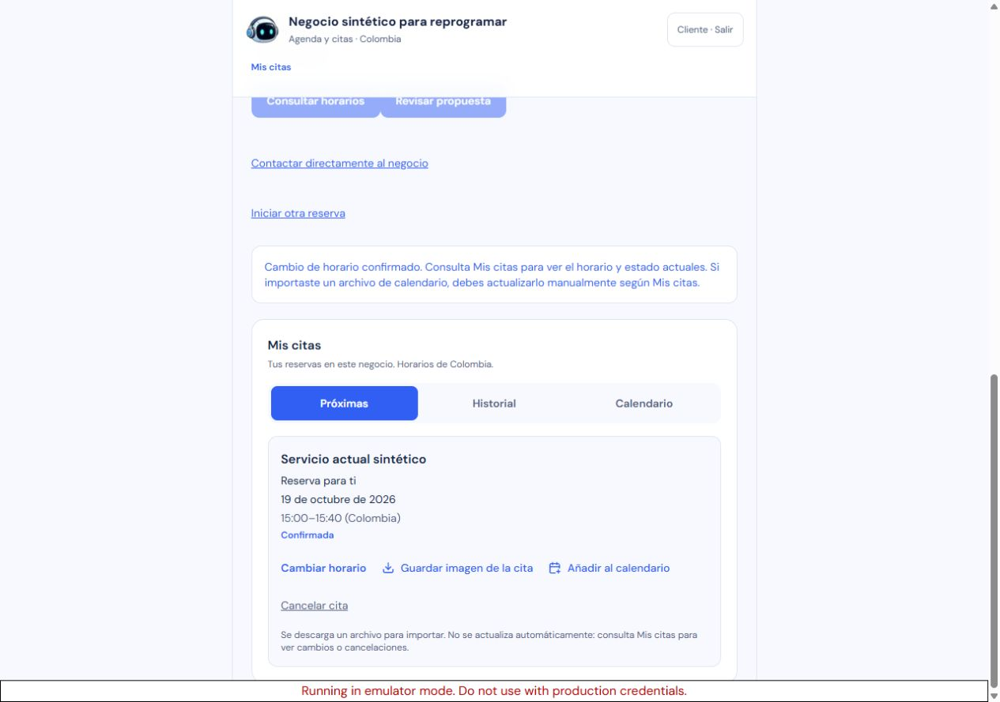

# Cambiar horario de una cita: publicado

Estado: publicado con autorización específica. Runtime publicado `97b65723ad35994c49f56f15a73367ba33a6eb3c`.

El propietario autorizó implementar, probar y publicar cada adaptación antes de comenzar la siguiente. Esta entrega permite cambiar el horario de una cita propia futura confirmada desde Mis citas, conservando su identidad, cliente, contacto, respuestas y beneficiario. El resumen compara el horario anterior con el propuesto y muestra las condiciones actuales del servicio antes de confirmar.

Referencia consultada de nuevo el 17 de octubre: la [guía oficial de Fresha](https://www.fresha.com/help-center/knowledge-base/calendar/263-reschedule-appointments) describe conservar la información de la cita al cambiar fecha, hora o profesional y remitir al negocio cuando el servicio deja de estar disponible. Sarin adapta ese recorrido al cliente con sus propios permisos y reglas comerciales.

La ocupación original permanece hasta confirmar la sustitución atómica. El cambio no crea otra cita ni consume una unidad del plan. La respuesta de una confirmación perdida se recupera como la misma operación; una repetición no vuelve a mover la cita. El resultado original se distingue de la lectura actual cuando hubo cambios posteriores.

Las citas con beneficiario declarado requieren un caso nuevo con tipo y rol fijos y los permisos actuales que correspondan. Las citas antiguas sin beneficiario conservan esa ausencia y solo admiten este recorrido cuando la política del negocio es general y no tiene menores habilitados. En los demás casos se indica contactar al negocio.

Protocolo: [contrato y casos de prueba](../../qa/tests/appointment-reschedule.md). Los archivos de calendario importados anteriormente requieren actualización manual.

## Verificación automática y revisión

- `pnpm test`: **1.390 aprobadas y 26 omitidas**, 138 archivos aprobados y cuatro omitidos; 120 pruebas nuevas frente a la versión publicada anterior.
- `pnpm run typecheck`: aprobado. `pnpm audit`: ninguna vulnerabilidad conocida.
- `pnpm --filter sarin-cloudflare-host run check`: **74 pruebas aprobadas**, tipos y dry-run del Worker aprobados.
- Revisión independiente de 14 archivos de runtime y nueve archivos de pruebas/contrato: **PASS sin P1/P2**, con hashes de la fuente revisada. No sustituye las pruebas ejecutadas por root ni acredita producción.

TDD detectó y corrigió la identidad de la cita, la vinculación completa de los metadatos al mapping, el reloj posterior a las lecturas, la cancelación del cliente al iniciar la cita y carreras entre acciones del mismo evento. Las regresiones de UI también cubren recuperación tras cambios de política, permiso y catálogo, incluyendo capability ausente y transición de una cita legacy a política de salud. Los mensajes afectados por una escritura local con codificación incorrecta se restauraron antes del cierre.

## Pruebas avanzadas

Ocho casos usan D1/Workerd real con dos conexiones: cambio atómico, locks del origen/destino/cliente, competencia por la revisión de origen, conflictos con una reserva o bloqueo manual, cancelación concurrente, secuencia A→B→A seguida de cancelación y retransmisión del mismo commit después de perder su respuesta. Se verifica que el resultado original permanece separado del estado actual y que no aparecen citas adicionales ni consumo de cuota.

Los contratos de las dos rutas nuevas y la confirmación existente cubren autenticación, validación estricta, ausencia de querystring, respuestas no-store y compatibilidad de nuevas reservas. Las pruebas de salud/menores conservan beneficiario y revisión de representación, exigen la autorización vigente del caso fijo y rechazan cambios de teléfono o respuestas. La ausencia histórica de beneficiario no se convierte en una declaración nueva.

## Navegador local

**44 controles de Chrome** a 320, 390 y 1280 px con proyecto `demo-sarin-bot`. El fixture tiene un negocio único y una cita futura propia: 18 de octubre, 14:00–14:30, profesional origen, precio anterior $25.000. El servicio vigente vale $30.000, dura 40 minutos y tiene cinco minutos de buffer. La prueba comercial ya usó 10/10 citas y el cliente tiene límite de una cita futura, que está alcanzado.

Se comprobó acceso desde «Ver mis citas», fuente/beneficiario fijos, ausencia de teléfono o preguntas nuevas, consulta explícita, día vacío, rechazo del mismo horario, foco y bloqueo de PNG/ICS/cancelación/otras reservas durante el cambio. Una propuesta para el 19 de octubre, 15:00–15:40 con profesional destino, dejó la cita y los contadores originales intactos según `record proposed`.

Tras confirmar, el ensayo interceptó **solo la respuesta Fetch de confirmación local**, comprobó HTTP 200 y la prueba de revisión 1, y simuló un fallo de red antes de entregarla a la UI. La pantalla bloqueó abandono y otras operaciones y permitió recuperar. El segundo POST usó exactamente la misma ruta y cuerpo y devolvió la misma prueba. `record changed` y `record replay` comprobaron un único cambio, identidad y datos originales, locks 2/1/2 y contadores sin cambios. La lectura actual mostró una sola cita en el nuevo día; el día anterior e Historial quedaron sin otra cita y su horario volvió a estar disponible.

La descarga real ICS tiene 541 bytes, UID derivado de la misma cita, horario `20261019T200000Z–20261019T204000Z` y profesional actualizado; excluye contacto y respuestas. La imagen PNG tiene 149.001 bytes y 1080×1148 px y se inspeccionó visualmente con el nuevo horario/profesional. Se abrió la confirmación de cancelación y se eligió «Conservar cita», sin ejecutar cancelación. La captura de red completa del recorrido, sin cabeceras de autorización, contiene una propuesta, dos confirmaciones de la misma operación y consultas diarias; no hubo solicitudes de IA ni otras escrituras de negocio.

El observador de descarga del harness agotó su espera para ICS; el evento `Page.downloadProgress` completado y el archivo real confirmaron la descarga. Los campos nativos de fecha de Chrome requirieron eventos de teclado después de fill. Un primer registro del fixture rechazó una ampliación tardía del esquema local de anclaje Auth: se restauró exactamente el esquema capturado, sin editar manifiesto, fingerprints ni datos, y los registros posteriores pasaron. Se conserva el log fallido junto a los aprobados.

## Limpieza y límites

La limpieza validó todos los inventarios, anclajes y fingerprints antes de eliminar **15 documentos propios**. Conservó cuatro documentos compartidos y las tres identidades Auth sintéticas. Se cerró la pestaña local, se restauró el viewport y se detuvieron únicamente los árboles de procesos propios del preview y los emuladores; seis puertos se verifican libres en el cierre. Los dos archivos generados en Descargas se eliminaron después de compararlos con sus copias de QA por hash.

Las evidencias privadas están bajo `qa/reports/appointment-reschedule*` y se copiarán al paquete de publicación. Se alteró una cita sintética y se creó una propuesta local; el navegador no creó otra cita. No se aceptaron consentimientos ni se crearon o cambiaron citas, direcciones o datos reales. La autenticación administrativa se reverificará al publicar. No se atribuye importación ni sincronización con un calendario externo.

La reversión prevista es la versión publicada de ubicación y modalidad: runtime `8da7c5494f578d04af09f9a20e470d2c913e222b`, imagen `sha256:d59fa71083e4e76c62b15959818e19d0bad6ae28c3aa2f52c2dae4d22a9dfcff`, Containers v17. Sin migraciones SQL ni cambios de bindings. Conserva las citas en su estado actual con metadatos opcionales; v17 no ofrece el nuevo recorrido ni confirma o recupera sus propuestas. Revertir código no restaura horarios anteriores.

Publicado después de la autorización registrada: «ok vamos paso a paso, implementando probando y publicando, y pasamos al otro». El artefacto congelado es `97b65723ad35994c49f56f15a73367ba33a6eb3c`; los commits posteriores de documentación se distinguen del runtime.

## Publicación verificada

Cierre: `2026-10-18T00:40:50.655Z`. Autorización: «ok vamos paso a paso, implementando probando y publicando, y pasamos al otro», limitada a esta reprogramación de cita. Worker `ee6fc3fb-9661-4558-96f2-d4ae023ae141`, Containers v18, allocation `d03f4b9a-fc34-4e42-b476-59bff56c5d52`, imagen `sha256:f3dcad7f89f0b81200938039890e7e8516eab3bfd0a101a25aa01fd78bbb567b`. Una instancia running/connected, cero antiguas y paginación completa; mantenimiento desactivado, bindings/variables/13 secretos/presupuesto y Pages `a461b670-5130-41e7-8c75-957f5439cfd7` conservados.

| Etapa | Hora | Scope | HTTP | Activas/cola/críticas/normales |
| --- | --- | --- | --- | --- |
| Antes | 2026-10-18T00:28:57.358Z | default | 200 | 0/0/0/0 |
| Drenaje | 2026-10-18T00:31:46.143Z | engine | 200 | 0/0/0/0 |
| Reapertura | 2026-10-18T00:39:11.237Z | default | 200 | 0/0/0/0 |

HTTP: `/` 200; `/ayuda` 200; `/privacidad` 200; `/b/sarin-pruebas-20261015` 200; `/dashboard/onboarding` 200; `/manifest.webmanifest` 200; `/api/session` 401; `/api/businesses` 401; `/api/businesses/synthetic-reschedule/reschedule/availability` 401; `/api/businesses/synthetic-reschedule/reschedule/proposals` 401; `/api/businesses/synthetic-reschedule/booking-proposals/synthetic-proposal/confirm` 401. Perfil público con allowlist verificada; iconos: `/brand/sarin-face-192.png` SHA-256 `bec2324dd74f8d0dbc476b5b580c5b2eca65aff171426574706071a40724541e`; `/brand/sarin-face-512.png` SHA-256 `bfe3c69878d4089d14076be0394acb67bc42fc879a0111e1bbfb855b70e85482`. El nuevo marcador y los anteriores se verificaron como bundle_only; no se infiere UI visible.

Acción visible: no; flujo no atribuido como observado. Límite real: La ficha real Sarin Pruebas muestra No tienes próximas citas; los permisos del negocio siguen pendientes y se conservaron sin aceptarlos. No se creó ni modificó una cita real para exponer la acción o el flujo. UI completa validada localmente con 44 controles y 1 cita sintética alterada, 1 propuesta local y 0 citas nuevas creadas por el navegador. La autenticación administrativa final se reverificó; los límites de observación durante la preparación local conservan su propia fecha en el paquete. No se aceptaron consentimientos ni se crearon/alteraron citas o datos reales para QA.

Reversión compatible: `8da7c5494f578d04af09f9a20e470d2c913e222b`, imagen `registry.cloudflare.com/05fb22c155667de064b55c4e287b21d8/sarin-bot@sha256:d59fa71083e4e76c62b15959818e19d0bad6ae28c3aa2f52c2dae4d22a9dfcff`, Worker `d23f4df4-e256-468b-9168-f0c08e18161d`, Containers v17; sin migraciones ni borrado. Límite funcional de reversión: v17 sirve las citas del mismo ID ya actualizadas, pero no incluye la interfaz ni la confirmación de nuevas propuestas de reprogramación. Las confirmaciones pendientes requieren volver a esta candidata o una resolución operativa explícita. El código anterior no revierte horarios ya cambiados; los calendarios importados requieren actualización manual. La reversión no migra ni borra datos.

### Recuperación operativa y orden de verificación

El mantenimiento bloqueó `/api/session` durante una renovación normal de Firebase. La identidad siguió conectada, pero el panel perdió temporalmente su clasificación administrativa. No se cerró la sesión, extrajeron tokens ni simularon roles. La instancia candidata se inició mediante una petición con credencial sintética inválida que devolvió **401**, sin datos ni cola; la auditoría independiente comprobó la imagen exacta, una instancia nueva running/connected y cero antiguas antes de reabrir.

Se documentó una excepción al orden previsto: la cola candidata se midió **después de reabrir**, a las `00:39:11.237Z`, 21,358 segundos después del evento registrado de reapertura. La medición autenticada con el proveedor activo y scope `default` devolvió HTTP 200 y los cuatro contadores a cero. Antes de reabrir, el estado vacío de la cola nueva fue una inferencia del código y la topología, no una medición: el proceso anterior estaba drenado y eliminado, el nuevo inicializa vacío, el mantenimiento bloquea inferencia y WhatsApp/retención están deshabilitados. Hubo una ventana breve de admisión de tráfico legítimo antes de esa medición.

El sondeo separado de Ollama con scope `engine` no produjo una cola utilizable tras la reapertura; no se atribuye disponibilidad de ese motor ni se fabricó `queue-after-rollout.json`. Ambos scopes consultan la misma cola del proceso. Existen **tres muestras autenticadas reales**, las de la tabla, y revisión independiente de esta recuperación. Los controles del cierre validaron la excepción, la cronología y la medición dentro del primer minuto; no se cambió el runtime congelado para resolverla. El paquete privado conserva `reopen-recovery-decision.json`, `independent-recovery-review.json`, `warmup-auth-boundary.json`, las auditorías originales y el helper ejecutado con esta excepción explícita.

Seguimiento operativo: permitir la consulta autenticada de sesión necesaria para conservar el panel durante mantenimiento, con pruebas de frontera de autorización antes del próximo despliegue. Esta mejora no forma parte del runtime v18 publicado.
