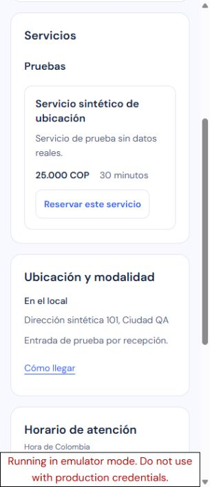
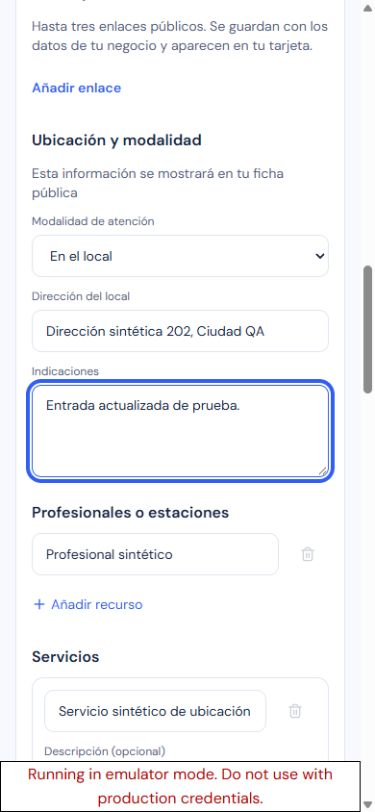
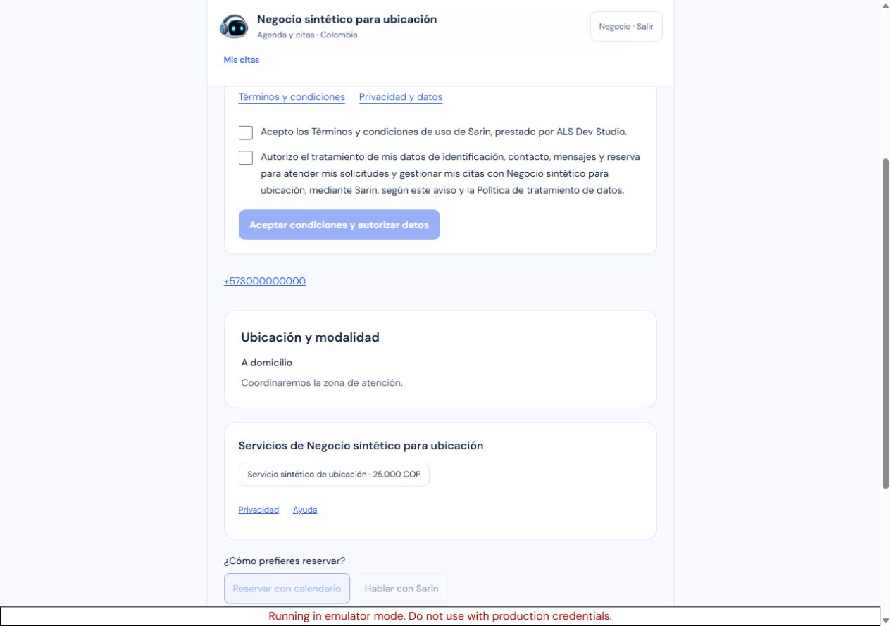

# Ubicación y modalidad: aceptación local

Estado: aprobado localmente. Publicación autorizada pendiente de ejecutar y verificar.

Tercer incremento de «ok vamos paso a paso, implementando probando y publicando, y pasamos al otro», iniciado después de verificar el calendario publicado (runtime `ba34b40`, Containers v16).

## Comportamiento y contrato

El propietario puede publicar En el local, A domicilio o En línea, con dirección presencial opcional de hasta 200 caracteres e indicaciones de hasta 500. Sin publicar quita la sección. La dirección se descarta al cambiar a otra modalidad. La ficha muestra la misma sección antes y después del acceso; no exige autorizar nuevas reservas para consultar esos datos públicos.

Cómo llegar es un enlace normal a Google Maps con dirección codificada, host fijo, nueva pestaña, noopener/noreferrer y no-referrer. No hay mapa incrustado, geolocalización, API key o código que consulte Google automáticamente. [Formato oficial Maps URLs](https://developers.google.com/maps/documentation/urls/get-started).

`Business.location` es JSON opcional. El request admite objeto válido, null para quitarlo u omisión para conservarlo desde clientes anteriores. Validación estricta por modalidad, normalización de vacíos, límites y controles; texto sin interpretar HTML. Las proyecciones públicas usan campos permitidos y omiten ubicación histórica malformada. Se mantienen propietario, decisiones y suscripción actuales; privado y público se guardan en la misma transacción. Sin migración SQL, dependencias, permisos o configuración Worker nuevos.

Nueve archivos runtime: módulo compartido, tipos, schemas, negocios, sección pública, editor, perfil anónimo, ficha autenticada y configuración. El editor conserva cambios locales frente al polling y ubicación frente a un borrador del asistente que omite ese campo.

## Evidencia

- TDD backend: 12 fallos iniciales y dos de Maps; foco final 111/111 con regresiones. UI: 13 fallos iniciales y dos de integración; 22 pruebas nuevas y 59 de regresión dirigidas aprobadas.
- Suite completa: **1.270 aprobadas / 26 omitidas**, 130 archivos aprobados / cuatro omitidos. `qa/reports/business-location-all-tests.log`.
- Typecheck final y audit aprobados. Se restauró next-env.d.ts generado por la preview; un fixture histórico ignorado se adaptó al nuevo tipo nullable sin ejecutarlo.
- Revisión independiente estática PASS, sin P1/P2. Catorce hashes de runtime/pruebas coinciden después de QA; el revisor no atribuye una ejecución propia de navegador o guardado real. `qa/reports/business-location-independent-review.json`.
- **31 controles manuales CUA**, 320×740, 390×844 y 1280×900. Preview local compilada con debug-prerender solo para acceso sintético a emuladores; imagen normal pendiente de construir.

Negocio y propietario sintéticos de demo-sarin-bot, un servicio, un profesional, cero citas/propuestas sembradas. Cuatro POST reales desde configuración: presencial con dirección nueva, en línea, a domicilio y sin publicar. Cada fase se verificó contra snapshots canónicos de negocio y proyección pública: cambió exclusivamente location, con ubicación esperada exacta. Lectura pública independiente y UI autenticada reflejaron cada fase; al quitarla no quedó tarjeta o mapa vacío. No se creó ninguna cita ni se aceptaron decisiones reales.

Móvil: controles de 44 px, textarea de 96 px, límites 200/500 y foco visible. Ningún desbordamiento horizontal en los tamaños medidos. Las tres capturas finales se inspeccionaron.

Red: traza completa del propietario con cuatro POST /api/businesses. Ningún HTTP externo observado, inferencia o propuesta. La traza retenida del perfil tampoco mostró HTTP externo, pero su buffer perdió eventos iniciales; no se atribuye cobertura completa a esa traza. Recursos chrome-extension/data se separan de HTTP. El enlace Maps se inspeccionó sin abrir un mapa externo. Consola sin errores o avisos.

Límites del harness: el banner fijo exclusivo de emuladores cubrió el centro del botón Guardar en el primer clic de la fase online; no hubo POST y el guard rechazó record online. elementFromPoint confirmó la obstrucción; Enter guardó una sola vez. El log rechazado se conserva por separado. Viewport afectaba la pestaña seleccionada del propietario: la medida de 320 px de la otra pestaña no se atribuye a escritorio; se navegó en la pestaña seleccionada y se midió 1280×900 antes de la captura final.

## Limpieza y publicación

Siete documentos propios eliminados después de validar IDs, propietario, huellas y ausencia de datos posteriores; siete documentos compartidos y cuentas Auth conservados. Las cuatro verificaciones de cambios solo de ubicación quedan en el manifiesto. Procesos propios detenidos, seis puertos libres por bind exclusivo, viewport restaurado y ambas pestañas locales cerradas. La autenticación real no se alteró en QA y se verificará al cerrar producción.

Publicación autorizada pendiente: congelar esta revisión, construir y auditar imagen, activar mantenimiento, drenar cola, sustituir la instancia única, reabrir y verificar producción.

Reversión compatible: runtime `ba34b408024c97c909a774f07c5dde6263644f91`, imagen `sha256:188cbc13955f154678498930e89203e7e5fcfeae957974ac70bc74c898edb4ad`, Worker `6bd8b289-f1e1-4bfa-9961-05afcc16ad41`, Containers v16. El campo opcional privado se conserva al volver al código anterior; no se requiere migración ni borrado de datos.
