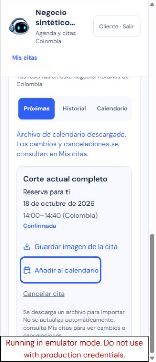
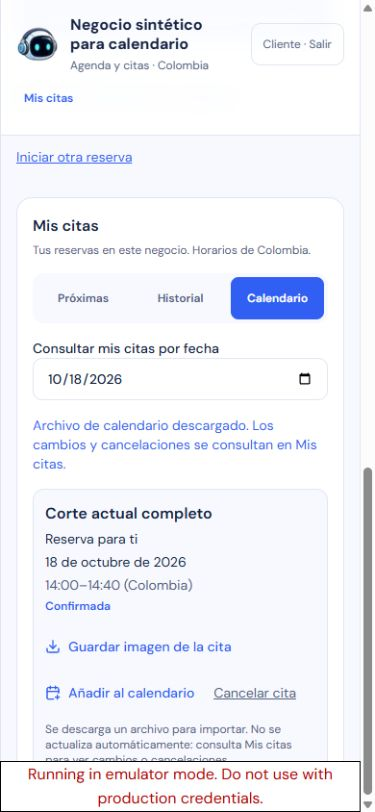
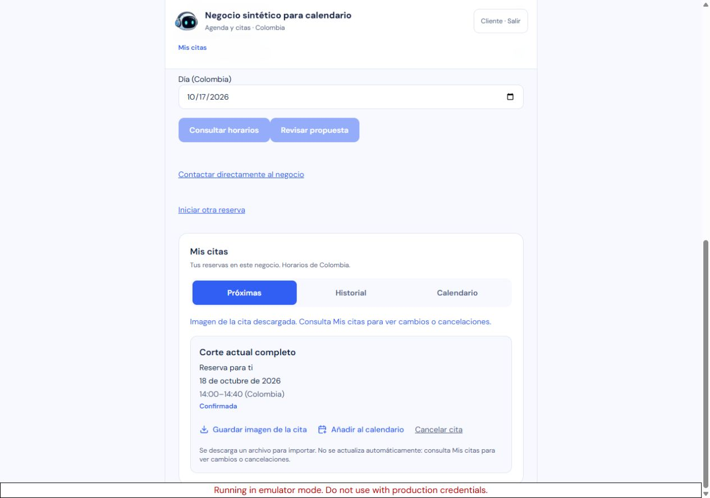

# Añadir cita al calendario: aceptación local

Estado: aprobado localmente. Publicación autorizada pendiente de ejecutar y verificar.

Segundo incremento de la secuencia indicada por el propietario: «ok vamos paso a paso, implementando probando y publicando, y pasamos al otro». Se comenzó después de publicar y verificar la búsqueda de próxima fecha (runtime `1b81385`, Containers v15).

## Comportamiento

Mis citas ofrece **Añadir al calendario** para citas futuras confirmadas de la cuenta actual. La descarga es un archivo ICS para importar con servicio, negocio, profesional si está disponible y horario exacto. El identificador es estable por negocio/cita mediante SHA-256; los identificadores originales no aparecen en el archivo. No se exportan contactos, beneficiarios, notas privadas ni respuestas del cliente. Guardar imagen de la cita sigue disponible.

El aviso visible y la descripción del archivo explican que la copia no se actualiza automáticamente. Los cambios y cancelaciones se consultan en Mis citas. No se configura una alarma, suscripción o envío automático. La preferencia del propietario para el paso posterior de recordatorios es «todo dentro de la app de momento».

Tres archivos runtime: generador ICS, adaptador con campos permitidos y ClientAppointments. Sin dependencias nuevas, rutas, cambios en Worker, esquema, migraciones o escrituras del negocio.

## Evidencia automatizada y revisión

- TDD del generador/adaptador: contrato y descarga, validaciones e identidad; 42 pruebas aprobadas al finalizar. UTC, cruce de medianoche, escape, CRLF, líneas UTF-8, UID estable, separación entre negocios/citas y exclusión de datos privados.
- TDD de UI: 36 fallos iniciales por la función ausente y dos regresiones de handlers PNG/cancelación de otro ámbito; 80 pruebas aprobadas junto a las existentes de PNG/citas/rebooking. Bloqueo mutuo, lectura fallida, cambio de cuenta/negocio, desmontaje, reloj, metadatos y estado obsoletos, descarte después de await y reintento explícito.
- Suite completa final: **1.183 aprobadas, 26 omitidas**; 125 archivos aprobados y cuatro omitidos. `qa/reports/calendar-export-all-tests.log`.
- Tipos: `pnpm run typecheck` aprobado después de restaurar next-env.d.ts generado por la preview. Audit de producción sin vulnerabilidades conocidas.
- Revisión independiente de los tres runtime y pruebas: PASS, sin P1/P2. Revisión estática, con hashes de fuente; el revisor no atribuye una ejecución propia de navegador o importación. `qa/reports/calendar-export-independent-review.json`.

Formato contrastado con [RFC 5545](https://www.rfc-editor.org/rfc/rfc5545), secciones 3.1, 3.3.5, 3.3.11 y 3.8.4.7.

## Navegador y archivos reales

**28 controles manuales CUA**, en 320×740, 390×844 y 1280×900. Preview compilada local con `--debug-prerender`, usada solo para conservar el acceso sintético a emuladores; la imagen de producción usa build normal. Cliente `demo-sarin-bot`, negocio único, cuatro citas sembradas y diez documentos propios.

Dos descargas ICS de 535 bytes completadas por el navegador. Los archivos reales se inspeccionaron desde Downloads: mismo UID, inicio `20261018T190000Z`, fin `20261018T194000Z`, equivalentes a 14:00–14:40 de Colombia. Servicio, negocio y profesional correctos; CRLF/plegado y exclusión de datos privados verificados. No se importaron en una aplicación externa ni se atribuye sincronización con un proveedor de calendario.

PNG conservado: descarga completada de 143.469 bytes. Historial con citas pasadas/canceladas sin exportación y rebooking conservado; Calendario por fecha selecciona la cita futura. En los tres tamaños no hubo desbordamiento horizontal; controles móviles de 44 px y foco de teclado visible en 320 px.

La observación de red comenzó antes de la primera exportación y después del login sintético: 48 solicitudes, todas GET de lectura/polling; ninguna escritura, inferencia, propuesta o confirmación durante ese intervalo. Consola sin errores o avisos. `qa/reports/calendar-export.browser.result.json`, `calendar-export.network.json` y los informes de los dos archivos descargados contienen los límites y metadatos.

Límites del harness: waitForEvent(download) agotó su espera en la primera descarga, mientras CDP indicó completed y el archivo real existía; no se repitió el clic para resolver esa espera. El control nativo de fecha incrementó primero el mes; se restauró y se eligió el 18 de octubre con teclado, comprobando la tarjeta mostrada. La captura final de 390 px reemplaza un encuadre inicial que mostraba solo la fecha.

## Limpieza y publicación

Limpieza transaccional por IDs, propietario y huellas: diez documentos propios eliminados, cuentas Auth y decisiones compartidas conservadas. Sin propuestas o citas creadas por el navegador. Preview y árbol de emuladores propios detenidos; seis puertos comprobados libres mediante bind exclusivo. Viewport restaurado y pestaña local cerrada.

La sesión real no se alteró durante QA local; su autenticación final se verificará por separado tras la publicación. No se aceptaron consentimientos ni se editaron datos reales para fabricar cobertura.

Publicación autorizada pendiente: congelar esta revisión, construir y auditar imagen, activar mantenimiento, drenar cola, sustituir la instancia única, reabrir y verificar producción.

Reversión compatible prevista: runtime `1b8138582a2784748537a7f1905db29368c9e57e`, imagen `sha256:d7ee223446ef4609137056572e3adbfdecb2233828a402afbc1ab46e8d42f617`, Worker `2e25bd87-70ab-4f7d-bcdb-9eed349ec8d0`, Containers v15. Sin migraciones ni borrado de datos.
