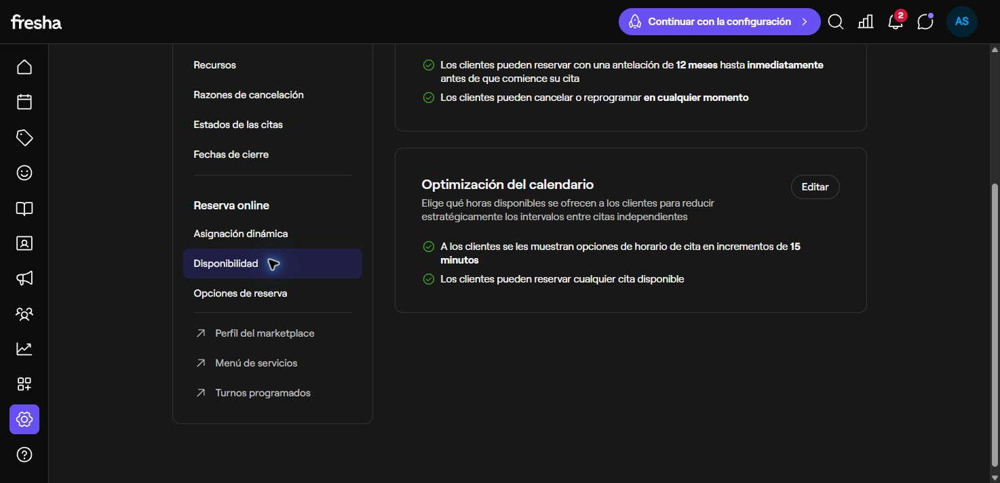

# Fresha: perfil, disponibilidad y reserva

**Actualización de la comparación de código:** este informe consultó un checkout mixto anterior a varias funciones ya publicadas. Para el estado vigente de reserva estructurada, propuestas, logo y QR, consultar la [revisión contra las fuentes reales de producción](2026-10-17-fresha-services-and-team.md). Las observaciones de las pantallas de Fresha se conservan como evidencia de esta visita.

Revisión del 17 de octubre de 2026 (Colombia). Continúa el [análisis inicial](2026-10-16-fresha-analysis.md) y el [registro anterior](2026-10-16-fresha-onboarding-followup.md). Se navegó la cuenta ya abierta mediante su interfaz, sin guardar formularios, publicar el negocio, aceptar condiciones, introducir medios de pago ni confirmar citas. No se copian contactos privados ni el token del enlace de vista previa.

## Hallazgos comprobados en la interfaz

| Pantalla | Lo observado | Aplicación propuesta a Sarin |
| --- | --- | --- |
| [Resumen del perfil](https://partners.fresha.com/fresha/online-booking/profile/edit/3227344/overview) | Tres bloques: datos del negocio, presentación online y activación de reservas. Progreso inicial 0%; el formulario de datos básicos muestra nombre comercial y contactos, con vista previa y Guardar y salir. | Separar configuración, revisión y publicación. Mantener borradores recuperables. |
| Vista previa del negocio | Perfil accesible, sin reseñas, con dirección/horario; aviso de reservas desactivadas y botón Reservar ahora inhabilitado. | Un perfil visible no acredita que el negocio pueda recibir reservas. Mostrar un estado real y verificable. |
| [Generador de enlaces](https://partners.fresha.com/fresha/online-booking/buttons-and-links) | Ofrece un enlace general y enlaces por servicios, centro o profesional. Crear enlace a servicios abre un aviso que exige publicar el perfil. No se generó un enlace ni QR. | Conservar el QR directo de Sarin independiente de un futuro directorio. Un enlace por servicio puede preseleccionarlo, pero el servidor debe validar su vigencia. |
| [Disponibilidad](https://partners.fresha.com/setup/scheduling/availability) | Configuración de esta cuenta: ventana de 12 meses, reserva hasta inmediatamente antes de la cita, cancelación/reprogramación en cualquier momento e intervalos de 15 minutos. Son valores observados de esta cuenta, no valores obligatorios de Fresha. | Añadir antelación mínima, ventana máxima y plazo de cancelación como reglas deterministas cuando se acuerde ese incremento. |
| Misma pantalla | Optimización del calendario separada del intervalo: esta cuenta permite cualquier cita disponible. | Mantener inicialmente todos los huecos válidos. La optimización para reducir huecos es una mejora posterior. |
| [Opciones de reserva](https://partners.fresha.com/setup/scheduling/booking-options) | Ajustes separados para visibilidad/selección del equipo, imágenes y destacados del servicio, reservas de grupo, información previa y avisos al equipo. | Priorizar información de reserva y claridad de servicio. Grupos, venta adicional y preferencias complejas de equipo pueden esperar. |
| [Perfil activo de ejemplo](https://www.fresha.com/es/a/maicol-ramos-grooming-private-bogota-carrera-11a-93a-80-cgal2648) | Fotos, categorías, descripción, duración y precio visibles sin acceso. La ficha de CORTE EXECUTIVE mostraba 50 minutos y 60.000 COP; Añadir lleva a selección de servicios con resumen y total. Estos son datos del ejemplo, no precios de Sarin. | Dar información suficiente antes de pedir acceso. Reutilizar los precios y duraciones reales del negocio. |
| Reserva del ejemplo | Recorrido Servicios → Hora → Confirmar; el servicio preselecciona al profesional único. Se consultaron el 17 y el 19 de octubre. En ambos casos, tras cargar, indicó ausencia de disponibilidad y Continuar deshabilitado; ofrecía otra fecha y lista de espera. | Diseñar el estado sin horarios, otra fecha y vuelta a servicios. No prometer disponibilidad por tener un perfil publicado. |

No se llegó a la confirmación autenticada: el ejemplo no ofreció un horario en las fechas consultadas. No se creó una cita ni se solicitó lista de espera. La pestaña del propietario se devolvió a la URL inicial.

## Documentación oficial y límites

La [guía de publicación](https://www.fresha.com/help-center/knowledge-base/online-presence/266-create-your-online-profile) distingue el horario público de los turnos reservables del equipo. También describe fotos, descripción y activación final; permite guardar el progreso. Son pasos documentados, no pasos completados en esta revisión.

La [guía del recorrido del cliente](https://www.fresha.com/help-center/knowledge-base/online-presence/102398-learn-how-clients-book-appointments-online) confirma exploración sin cuenta y acceso al confirmar, con resumen de servicio, profesional, fecha e importe. La interfaz consultada confirmó exploración y selección, pero no una confirmación final.

La [guía de optimización](https://www.fresha.com/help-center/knowledge-base/calendar/496-optimize-online-schedule-availability) describe horarios regulares, reducción y eliminación de huecos. La [ayuda enlazada desde Disponibilidad](https://www.fresha.com/es/help-center/knowledge-base/calendar/101218-manage-online-bookings-settings) no fue accesible mediante el lector web remoto; los valores de esa pantalla proceden de navegación real en la cuenta.

## Correspondencia con el código vigente de Sarin

| Base actual | Brecha concreta | Puntos de cambio para un incremento futuro |
| --- | --- | --- |
| Negocio con slug, contacto, servicios y recursos | Descripción, modalidad, ubicación e imágenes públicas | `src/types/firestore.ts`, `src/lib/server/schemas.ts`, `src/app/dashboard/onboarding/page.tsx` |
| `/b/[slug]` protegido completo por AuthGate | Perfil y servicios visibles antes del acceso; precio y duración juntos | `src/app/b/[slug]/page.tsx` |
| Reserva por herramientas del chat | Selección directa de servicio/recurso/fecha y resumen antes de confirmar | `src/lib/server/bookings.ts`, `src/lib/sarin/availability.ts` y nuevos contratos específicos |
| POST de appointments reservado a bloqueos del propietario | No es una API de confirmación del cliente; no reutilizar ese permiso sin diseñar autorización | `src/app/api/businesses/[id]/appointments/route.ts` |
| Horario semanal común, buffers, bloqueos y pasos de 15 minutos | Antelación, ventana máxima configurable, plazo de cancelación y, después, turnos individuales | `src/lib/sarin/availability.ts`, `src/lib/server/bookings.ts` |
| `publicBusiness()` incluye configuración del asistente y contadores | Un perfil/directorio nuevo necesita una proyección pública mínima propia | `src/lib/server/businesses.ts` |
| Mis citas e imagen PNG por negocio | Conservar autorización por usuario/negocio y formato vigente | `src/components/client-appointments.tsx`, `src/lib/client/appointment-image.ts` |

La reserva directa debe reutilizar los controles existentes de recursos, conflictos, idempotencia y consumo de prueba; la interfaz no decide el precio ni la disponibilidad definitiva. Los estados `completed` y `no_show` del tipo no acreditan por sí solos un flujo operativo para gestionarlos. La exportación vigente es PNG; las referencias anteriores a ICS son históricas.

## Orden recomendado, sujeto al alcance ya decidido

1. Terminar el piloto y su identidad/QR ya aprobados.
2. En V2, presentar perfil y servicios antes de Google; añadir datos comerciales útiles y reserva directa con resumen, más el estado sin horarios.
3. Añadir reglas de antelación/cancelación con validación en servidor. Separar horario público y turnos cuando el equipo real lo requiera.
4. Evaluar directorio solo después de diez negocios reales y una decisión manual del propietario.

Esta es una recomendación de implementación, no una ampliación automática del piloto. Se mantiene la decisión de [marketplace después de diez negocios](../product/marketplace-after-ten-businesses.md) y el [brief vigente](../product/BRIEF.md). No se implementó ninguna función de marketplace como parte de esta investigación.
