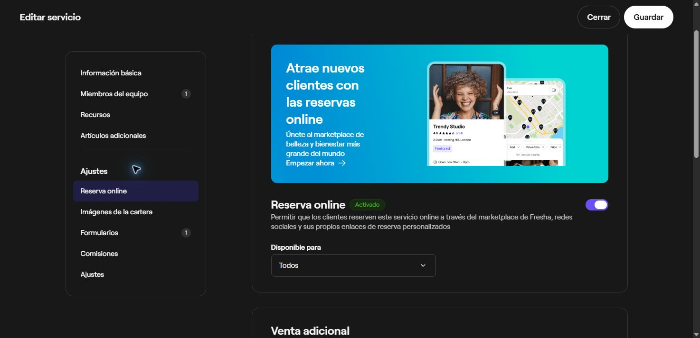

# Fresha: servicios, equipo y disponibilidad

Continuación del 17 de octubre de 2026. Objetivo: encontrar mejoras concretas para Sarin a partir del catálogo y la agenda de Fresha. Se revisó la cuenta ya abierta y documentación oficial. No se guardaron servicios ni turnos, no se publicaron perfiles y no se hicieron reservas o pagos.

## Base correcta de comparación

La comparación anterior usó el checkout mixto de `F:/Proyectos/Sarin Bot`, que contiene fuentes anteriores a algunas funciones ya publicadas. Esta revisión utiliza las fuentes exactas de producción: revisión de aplicación `6315379b8c0482af57fea20abd8e2e1af0c00ff1`, conservadas en el paquete privado del despliegue del favicon. La aplicación versión 8 añade únicamente los tres archivos del icono a esa base. No se ejecutaron pruebas funcionales nuevas sobre Sarin para este análisis de solo lectura.

El [informe anterior](2026-10-17-fresha-booking-followup.md) sigue siendo evidencia de lo observado en Fresha; su tabla de brechas de código no describe íntegramente esta versión de producción.

## Lo comprobado en la cuenta de Fresha

| Pantalla | Observación |
| --- | --- |
| Catálogo → Menú de servicios | Servicios agrupados por categoría, búsqueda por nombre y orden editable. La lista muestra precio y duración. |
| Editar servicio → Información básica | Nombre, categoría visible al cliente, tipo de tratamiento para descubrimiento, descripción opcional, precio, duración y tiempo adicional. El tipo de tratamiento no equivale a la categoría del menú. |
| Editar servicio → Recursos | Sección independiente de Miembros del equipo. Esta cuenta no tiene recursos configurados; la interfaz los presenta como medios para organizar disponibilidad y reservas sin un profesional. No se creó ninguno. |
| Editar servicio → Reserva online | Interruptor individual para permitir reservas; restricciones opcionales por fechas y por días/horas. La pantalla aclara que la disponibilidad del servicio depende del equipo y sus turnos. Un interruptor activo no publica por sí solo el negocio. |
| Equipo → Turnos programados | Cuadrícula semanal por persona. El aviso de la pantalla dice expresamente que la disponibilidad del equipo para reservar es independiente del horario habitual del negocio. |
| Turnos recurrentes | Frecuencia semanal, quincenal o personalizada; fecha inicial/final, días activos y varios intervalos por día. La pantalla indica que no programa turnos en fechas de cierre. Se abrió el formulario para leerlo y se cerró sin guardar. |

No se conservaron nombres ni turnos individuales del personal en este informe. La pestaña original del propietario quedó en el resumen del perfil; la pestaña temporal de investigación se cerró.

## Qué añade la documentación oficial

| Tema | Comportamiento documentado | Criterio para Sarin |
| --- | --- | --- |
| [Crear servicios](https://www.fresha.com/help-center/knowledge-base/catalog/284-create-services-1) | Precio fijo, desde o gratuito, además de descripción y duración. El precio «desde» requiere determinar el importe final posteriormente. | Mantener primero precio fijo. No introducir importes variables sin que el resumen explique qué confirma el cliente. |
| [Tiempo adicional](https://www.fresha.com/help-center/knowledge-base/catalog/101630-add-extra-time-to-services-and-appointments-1) | Distingue tiempo bloqueado, procesamiento y atención adicional. Durante procesamiento puede liberarse al profesional aunque el cliente siga en el establecimiento. | Conservar duración y margen de preparación actuales. No permitir solapamientos de procesamiento hasta que un negocio los necesite y el motor los modele. |
| [Recursos reservables](https://www.fresha.com/help-center/knowledge-base/calendar/101215-create-and-manage-resources) | Salas, equipos y espacios tienen disponibilidad propia y pueden reservarse automáticamente con la cita. Existen servicios que no necesitan profesional. | No confundir una persona con un equipo físico. Reservar simultáneamente profesional y sala exigiría ampliar el modelo y sus bloqueos transaccionales. |
| Misma guía de recursos | Si se vacía un tipo de recurso requerido, Fresha documenta que esa condición deja de aplicarse. También advierte sobre disponibilidad continua de servicios sin profesional si no se limita su horario. | No copiar esos resultados: una referencia rota debe impedir reservar y pedir corrección; todo servicio debe tener límites de disponibilidad explícitos. Esta es una recomendación para Sarin. |
| [Turnos del equipo](https://www.fresha.com/help-center/knowledge-base/calendar/252-schedule-and-update-team-shifts) | Patrones recurrentes y cambios de un día; los turnos determinan cuándo se puede reservar a la persona, independientemente del horario público. | Para una primera versión con equipo, usar horario individual y excepciones. Intersectarlo con el horario del negocio sería una decisión de Sarin, no una reproducción exacta de Fresha. |
| [Disponibilidad del servicio](https://www.fresha.com/help-center/knowledge-base/catalog/102404-manage-service-availability) | La reserva exige servicio habilitado, centro y profesionales aptos, y recursos requeridos disponibles. Cambiar asignaciones no reescribe las citas existentes. | Separar elegibilidad de nuevas reservas del historial. Una desactivación no debe cancelar citas guardadas. |
| [Reprogramar](https://www.fresha.com/help-center/knowledge-base/calendar/263-reschedule-appointments) | Conserva la cita y sus datos al cambiar fecha/hora o profesional. Los plazos del cliente y las facultades del personal son distintos. | Si se añade reprogramación, preservar identificador e historial, validar de nuevo el hueco y confirmar expresamente el cambio. Cancelar y crear otra cita no equivale a reprogramar. |
| [Cancelar](https://www.fresha.com/help-center/knowledge-base/calendar/286-cancel-appointments) | Pide confirmación y motivo, libera la agenda y conserva registro. | Conservar la cancelación autorizada existente; añadir motivos y plazos solo con reglas claras en servidor. |

## Estado real de Sarin

Rutas relativas a las fuentes de la aplicación publicada, no al checkout mixto:

| Capacidad | Estado comprobado en el código | Archivos |
| --- | --- | --- |
| Perfil antes del acceso | Pendiente: `AuthGate` envuelve toda `/b/[slug]`. | `src/app/b/[slug]/page.tsx` |
| Marca y captación directa | Ya hay logo del negocio, enlaces sociales y kit QR. No deben proponerse como funciones nuevas. | `src/lib/business-branding.ts`, `src/app/dashboard/qr-kit/page.tsx`, `src/lib/server/businesses.ts` |
| Servicios | Nombre, precio fijo, duración, buffer y recursos asignados. Sin descripción/categoría por servicio ni interruptor de reserva online. Las tarjetas del cliente muestran nombre y precio; pueden aprovechar la duración ya almacenada. | `src/types/firestore.ts`, `src/lib/server/schemas.ts`, `src/app/dashboard/onboarding/page.tsx`, `src/app/b/[slug]/page.tsx` |
| Reserva y resumen | Ya existe propuesta revisable antes de confirmar. El selector sin IA cubre salud y representación de menores según la política; no es todavía una alternativa general de calendario para cualquier adulto. | `src/components/booking-proposal.tsx`, `src/components/structured-booking.tsx`, `src/app/b/[slug]/page.tsx` |
| Contratos de reserva directa | Ya hay rutas específicas de disponibilidad, propuesta y confirmación. El POST de appointments sigue dedicado a bloqueos del propietario. | `src/app/api/businesses/[id]/availability/route.ts`, `src/app/api/businesses/[id]/booking-proposals/route.ts`, `src/app/api/businesses/[id]/booking-proposals/[proposalId]/confirm/route.ts` |
| Disponibilidad | Horario semanal común, recursos activos elegibles, conflictos por recurso, duración y buffer, pasos de 15 minutos. El recurso es una unidad única que puede representar persona o estación; no reserva ambas simultáneamente. | `src/lib/sarin/availability.ts`, `src/types/firestore.ts` |
| Reglas temporales | Las nuevas reservas exigen horas futuras y tienen un horizonte fijo de 366 días. No hay antelación mínima configurable, plazo de cancelación ni turnos individuales. La interfaz oculta la cancelación tras el inicio; el servidor comprueba autorización y estado confirmado, sin un plazo futuro equivalente. | `src/lib/server/bookings.ts`, `src/lib/sarin/availability.ts`, `src/components/client-appointments.tsx` |
| Gestión posterior | Consulta de citas, cancelación e imagen PNG existentes. No se encontró un flujo de reprogramación equivalente al de Fresha. | `src/components/client-appointments.tsx`, `src/lib/server/bookings.ts` |

## Próximo incremento recomendado

La mejora inicial con menos cambios en el motor es una **ficha pública por negocio antes de Google**, aprovechando el enlace y QR actuales:

1. Mostrar nombre, logo, servicios con precio y duración, horario comercial y contacto público ya configurado.
2. Al pulsar Reservar, iniciar sesión y continuar con los permisos y el recorrido actual. Esto no promete disponibilidad anónima ni cambia las condiciones para salud o menores.
3. Usar una proyección pública mínima. No mover simplemente toda la configuración del asistente, contadores, historial o consentimientos fuera de `AuthGate`.
4. Mostrar un estado claro cuando el negocio no acepta nuevas reservas, conservando el acceso del cliente a sus citas.

Después: descripción y agrupación de servicios; y, si los negocios iniciales tienen varios profesionales, horarios individuales. Antelación/cancelación y reprogramación requieren un incremento propio con validación transaccional. Fotos/portafolio, tipos de precio, procesamiento con solapamientos y recursos físicos conjuntos pueden esperar hasta comprobar una necesidad operativa.

El propietario eligió después explícitamente «Perfil del negocio visible antes de iniciar sesión» en la pregunta de prioridad. La implementación y verificación se preparan en la rama aislada `codex/public-business-profile-20261017`, basada en las fuentes del piloto publicado y conservando el favicon vigente. Esta elección no constituye un despliegue de producción.

El directorio entre negocios permanece reservado para [diez negocios reales y decisión manual](../product/marketplace-after-ten-businesses.md). La ficha accesible por enlace no exige activar un marketplace.
