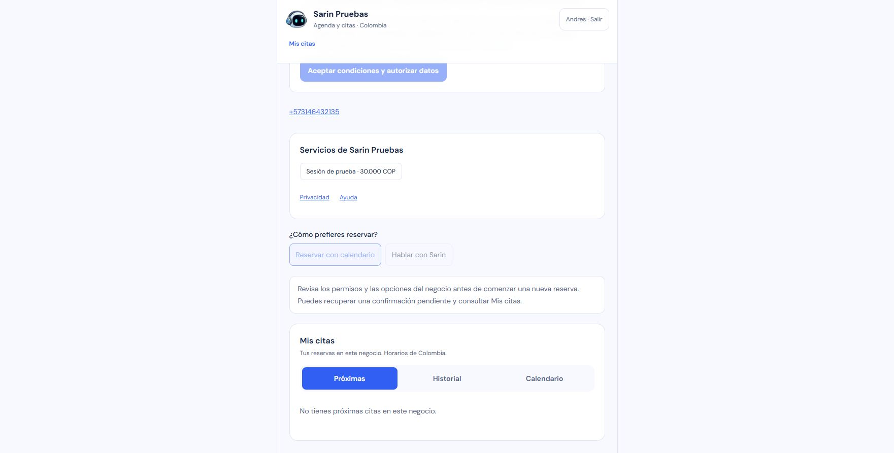

# Próxima fecha disponible: publicado

Estado: publicado con autorización específica. Runtime publicado `1b8138582a2784748537a7f1905db29368c9e57e`.

Primer incremento de la secuencia autorizada con «ok vamos paso a paso, implementando probando y publicando, y pasamos al otro». La aprobación incluye publicar cada versión probada antes de pasar a la siguiente. Esta entrega amplía el calendario existente; conserva Agenda clara, permisos, confirmación y recuperación.

## Contrato

Después de una consulta diaria correcta sin cupos aparece «Buscar próxima fecha disponible». La búsqueda es explícita y conserva servicio y profesional. Consulta desde el día siguiente al elegido, sin retroceder antes de hoy en Colombia; abarca hasta catorce días y se recorta al horizonte por fecha de 366 días. Devuelve la primera fecha con horarios y actualiza el día; no selecciona una hora ni crea una propuesta/cita automáticamente.

`POST /api/businesses/:id/availability/next` recibe `{ case, afterDateKey, serviceId, resourceId? }` y responde `{ nextAvailability: { dateKey, availability, fromDateKey, throughDateKey } }`. Un intervalo correcto sin cupos devuelve `dateKey: null`; una entrada inválida o un error de lectura no se presenta como agenda llena. Una consulta de appointments confirmados para el rango conserva el límite de lectura D1 y falla explícitamente si se supera, sin truncar citas que podrían ocultar conflictos.

El servidor conserva cuenta, negocio, autorización del caso, clasificación salud/menores, política de preguntas, suscripción y política del cliente. No cambia datos, consume citas/respuestas ni usa IA. El cliente descarta consultas obsoletas por identidad, selección, permiso, propuesta o desmontaje; las recuperaciones de confirmaciones inciertas siguen utilizando la operación original.

## Evidencia de preparación

- Baseline focal: cinco archivos, 44 pruebas aprobadas.
- TDD backend: 32 pruebas RED contra stub 501; después 32 GREEN y regresión focal de 77 aprobadas.
- TDD cliente inicial: 31 pruebas de hook y siete de UI RED; se incorporaron casos adicionales de congelación y desmontaje durante implementación.
- Integración adicional en D1/Workerd local: consulta real por rango, separación de negocios, ausencia de escrituras y de propuestas comprobadas. Es verificación de integración posterior a TDD, no RED retroactivo.
- Primera suite completa: 1.100 aprobadas y 26 omitidas. Es una corrida previa a corregir los hallazgos de revisión; no se presenta como aceptación final.
- Auditoría de dependencias sin vulnerabilidades conocidas.

## Revisión independiente cerrada

La revisión encontró dos casos temporales: el reloj podía avanzar durante la lectura y la sugerencia quedar pasada; también había que alinear el botón de confirmar con el permiso vigente tras una suspensión de suscripción. Ambos se corrigieron con regresiones RED/GREEN y reauditoría independiente PASS. La hora se vuelve a comprobar después de la lectura, la fecha colombiana al recibir la respuesta y la primera confirmación valida el permiso actual. La recuperación de una confirmación incierta conserva su operación original.

El recorrido de teclado detectó además que el foco se perdía al desaparecer el botón de búsqueda. Una regresión RED/GREEN añadió foco al mensaje de fecha encontrada; Tab continúa al primer horario. Revisión visual final a 320 px y escritorio correcta.

Validación final: **1.105 pruebas aprobadas, 26 omitidas**, tipos y auditoría de dependencias correctos. La última suite incluye la regresión de foco; el D1 local real está incluido. No quedan hallazgos materiales abiertos.

## Navegador y publicación

Se prepara la fixture única `proxima-fecha-qa-dfaf3000` en `demo-sarin-bot`, con permisos sintéticos preconfigurados. La preview local compila con `--debug-prerender` únicamente para conservar el acceso de prueba; la imagen de producción utilizará el build normal. Las advertencias de esa preview son específicas de QA y no se atribuyen al build de producción.

El [protocolo](../../qa/tests/next-available-date.md) se completó con **29 controles manuales CUA** en 320×740, 390×844 y 1280×900: éxito/vacío/error, continuidad de elección, hora manual y ausencia de operaciones automáticas. Ocho POST explícitos de disponibilidad, sin inferencia, propuestas ni confirmaciones. Un 503 se simuló únicamente sobre una consulta Fetch local; la intercepción se retiró. No se aceptaron decisiones ni se alteraron datos reales en producción.

La edición del día se verificó con teclado nativo y con el `dateKey` enviado al servidor. El llenado automatizado inicial del control nativo no se consolidó; no se atribuye como cambio exitoso. La primera comprobación de fieldsets se acotó a la región del calendario porque la página contiene también un fieldset de permisos. Los controles CUA son observaciones manuales registradas, no una suite headless automatizada.

Capturas revisadas: [día sin cupos y foco a 320](2026-10-17-next-available-empty-320.jpg), [fecha encontrada y foco a 320](2026-10-17-next-available-found-320.jpg), [carga a 390](2026-10-17-next-available-loading-390.jpg) y [profesionales en escritorio](2026-10-17-next-available-desktop.jpg). La captura a 390 muestra la carga; el rango vacío y el error se acreditan mediante observación DOM y pruebas de comportamiento, sin atribuirlos a esa imagen.

Se limpiaron exactamente diez documentos propios de la fixture, preservando las cuentas y decisiones compartidas. Se cerró la pestaña local, se restauró el viewport y se detuvieron la preview y los emuladores propios. Los puertos 3041/8080/9099/4400/4500/9150 quedaron libres, comprobados mediante bind exclusivo y cierre. La autenticación administrativa de producción no se reverificó durante QA local; se comprobará por separado después de publicar.

Publicado después de la autorización registrada: «ok vamos paso a paso, implementando probando y publicando, y pasamos al otro». El artefacto congelado es `1b8138582a2784748537a7f1905db29368c9e57e`; los commits posteriores de documentación se distinguen del runtime.

Base compatible anterior: runtime `0b3bf0558b48ded61f9869374bee75c80d29d22a`, imagen `sha256:d75c6c8e217de30ca2adde03a324ec56058be7306bda83e4cbcec0647b1e33bc`, Worker `f0695392-6b63-479e-a18c-af161f8ce017`, Containers v14. Esta función no incluye migraciones, cambios de secretos ni cambios de dependencias.

## Publicación verificada

Cierre: `2026-10-17T23:24:01.782Z`. Autorización: «ok vamos paso a paso, implementando probando y publicando, y pasamos al otro», limitada a esta búsqueda. Worker `2e25bd87-70ab-4f7d-bcdb-9eed349ec8d0`, Containers v15, allocation `d03329ef-b456-4b3e-96ec-fe5ab6f003fc`, imagen `sha256:d7ee223446ef4609137056572e3adbfdecb2233828a402afbc1ab46e8d42f617`. Una instancia running/connected, cero antiguas y paginación completa; mantenimiento desactivado, bindings/variables/13 secretos/presupuesto conservados.

| Etapa | Hora | Scope | HTTP | Activas/cola/críticas/normales |
| --- | --- | --- | --- | --- |
| Antes | 2026-10-17T23:19:21.677Z | default | 200 | 0/0/0/0 |
| Drenaje | 2026-10-17T23:21:14.395Z | engine | 200 | 0/0/0/0 |
| Rollout | 2026-10-17T23:22:25.418Z | engine | 200 | 0/0/0/0 |
| Reapertura | 2026-10-17T23:23:01.303Z | default | 200 | 0/0/0/0 |

HTTP: `/` 200; `/ayuda` 200; `/privacidad` 200; `/b/sarin-pruebas-20261015` 200; `/dashboard/onboarding` 200; `/manifest.webmanifest` 200; `/api/session` 401; `/api/businesses` 401. Perfil público con allowlist verificada; iconos: `/brand/sarin-face-192.png` SHA-256 `bec2324dd74f8d0dbc476b5b580c5b2eca65aff171426574706071a40724541e`; `/brand/sarin-face-512.png` SHA-256 `bfe3c69878d4089d14076be0394acb67bc42fc879a0111e1bbfb855b70e85482`. El nuevo marcador y los anteriores se verificaron como bundle_only; no se infiere UI visible.

Acción visible: no; flujo no atribuido como observado. Límite real: El negocio de prueba devuelve bookingAvailable=false y tiene los permisos del negocio pendientes. La ficha muestra la reserva deshabilitada. No se aceptaron condiciones reales ni se modificaron datos para activar el flujo. UI completa validada localmente con 29 controles. La autenticación administrativa final se reverificó; los límites de observación durante la preparación local conservan su propia fecha en el paquete. No se aceptaron consentimientos ni se crearon/alteraron citas o datos reales para QA.

Reversión compatible: `0b3bf0558b48ded61f9869374bee75c80d29d22a`, imagen `registry.cloudflare.com/05fb22c155667de064b55c4e287b21d8/sarin-bot@sha256:d75c6c8e217de30ca2adde03a324ec56058be7306bda83e4cbcec0647b1e33bc`, Worker `f0695392-6b63-479e-a18c-af161f8ce017`, Containers v14; sin migraciones ni borrado.
