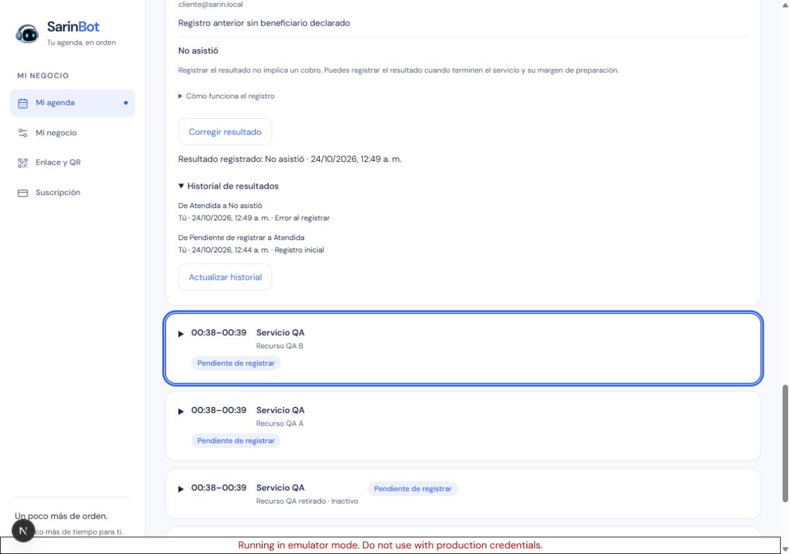
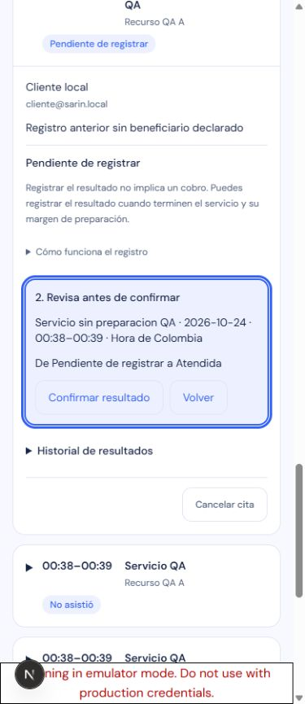
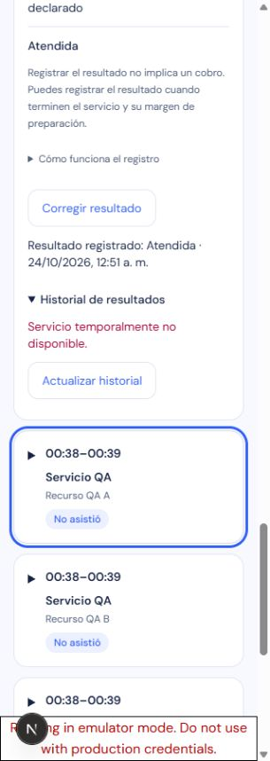

# Asistencia e historial privado — QA del 24 de octubre de 2026

Alcance: núcleo inicial P5 sobre P3/P4. El dueño puede registrar Atendida/No asistió al terminar el `reservedUntilAt` guardado, corregir por Error al registrar y consultar auditoría privada. Quitar resultado continúa diferido a S12. Este reporte acredita pruebas locales; no afirma todavía publicación ni restauración de producción.

Fuente: worktree aislado del host, base `b7e9a2811db1a9d31bfcabeb12f177e72d50e0da`, implementación hasta `fcbfbfc56649b4c266b544cd859e8296968b87fa`. No se ejecutó el checkout mixto E:. Node 24.22.0, pnpm 11.23.0, dependencias existentes; SHA256 del lock `f035b6bd0ddb862b899be3e15ec8115cf0a47ac508f8d1e644899aa902e12358` sin cambios.

## Gates locales

Los conteos focales se solapan con la suite general y no se suman.

| Gate | Resultado real |
| --- | --- |
| Suite general instalada equivalente a `pnpm test` | 3.749 pasan, 30 omitidas; 236 archivos pasan, 4 omitidos; exit 0 |
| Backend focal modelo/dominio/rutas/D1/compatibilidad/migración | 92 pasan en 6 archivos; exit 0 |
| Interfaz y regresión focal | 267 pasan en 15 archivos; exit 0 |
| Firestore SDK rules y Admin SDK reales en emulador | 28 pasan en 2 archivos; exit 0 |
| Worker completo | 156 pasan, ninguna omitida; exit 0 |
| Worker TypeScript y deploy dry-run sin Containers | Ambos exit 0 |
| TypeScript aplicación y build Next | Ambos exit 0; 39,05 s y 60,89 s respectivamente |

Evidencia externa: `work/p5-test-final.log`, `p5-task4-final.log`, `p5-task5-final.log`, `p5-rules-final.log`, `p5-worker-final.log`, resultados JSON y recibo `p5-qa-runs/2026-10-24T05-35-04-618Z-0e8540/rules-result.json`. La suite general omite pruebas que requieren emulador; el gate específico anterior sí ejecutó las de reglas/SDK. Las concurrencias D1 usan dos handles y Worker/SQLite reales locales. La caracterización de rollback reemplaza solamente la allowlist por la literal anterior, no ejecuta toda una imagen histórica.

La primera ejecución SDK detectó discrepancia 8080/8188 en el harness externo; se alineó solo el modo rules. La segunda detectó un reloj simulado incompatible con deadlines reales de GAX/gRPC; el fixture de integración pasó a una cita del día anterior sin alterar el reloj SDK. No se suprimieron pruebas ni aumentaron timeouts. Los tres intentos y logs se conservaron.

## Navegador real, solo datos sintéticos

Chrome, origen `http://127.0.0.1:3046`, proyecto `demo-sarin-bot`, Auth/Firestore emulados y proceso Next con entorno aislado. No hubo IA, mensajes, cobros ni citas de producción. Run: `p5-qa-runs/2026-10-24T05-38-05-569Z-2805c9`.

- Detalles e historial inicialmente cerrados. Seleccionar Atendida abrió revisión sin PATCH; solo Confirmar resultado escribió. Se retuvo un PATCH real: día, navegación y filtro quedaron deshabilitados; cerrar el detalle no canceló el guardado. La cita quedó Atendida.
- Se consultó el evento inicial y se corrigió a No asistió. Actualizar historial mostró ambos eventos, actor Tú, horas y motivo fijo. La corrección de un No asistió heredado mostró Sin auditoría registrada antes y conservó esa advertencia sobre el estado anterior después, sin inventar actor/fecha antiguos.
- Pérdida de respuesta: se interceptó la respuesta PATCH **200 después de que el servidor guardara** y se cerró la conexión. La interfaz informó resultado desconocido. Abrir historial mostró el evento y mantuvo Reintentar comprobación. El reintento envió cuerpo idéntico, devolvió el estado actual y el historial mostró un único evento inicial.
- GET retenido superó 10 s y mostró timeout. Otro GET se respondió sintéticamente 503; error junto al control y posterior Actualizar historial recuperó el evento. Se retiraron todos los interceptores.
- El margen pendiente y cita futura mostraron resultados deshabilitados en su observación temprana. Para `p5-boundary`, el helper cambió solo la reserva de un fixture aún sin eventos a `1792821364658`; antes se observaron botones deshabilitados y después habilitados, con guardado real exitoso a las 00:56 Colombia. El milisegundo exacto y reintentos con reloj fresco se prueban en backend, no se infieren del tiempo de interacción humana.
- Cita sin preparación: guardado Atendida con teclado. Recurso retirado: controles elegibles. Menor representado: guardado conservó declaración y controles de revisión. Cancelada: sin botones de registrar/corregir, conserva lectura histórica. Bloqueo: sin controles de asistencia.
- Salir durante un GET privado retenido eliminó el ámbito y volvió al acceso. Cliente local vio Completada por el negocio/Inasistencia registrada en Mis citas y cero controles Historial de resultados/Corregir resultado.
- Se prepararon dos dueños/clientes. El popup local mostró las cuentas secundarias pero las acciones de selección agotaron el tiempo, incluso por AX; se cerró el popup propio. **No se acredita recorrido visual del segundo dueño/cliente.** Aislamiento entre cuentas, autorización owner-only y denegación SDK sí se ejecutaron en pruebas backend/rules.
- Anchos reales 1280/390/320: sin desbordamiento horizontal; confirmación/Volver miden 44 px de alto. Enter abre revisión, foco pasa al resumen; Tab navega a Volver y Enter confirma. Atajos de zoom Playwright/nativos dejaron DPR 1 y ancho sin cambios: **no se acredita zoom nativo 200 %**, ni se sustituye por viewport.

Verificación final del inventario: 35 documentos, 4 cuentas, 13 citas, 6 cabezas y 7 eventos; 5 completed, 2 no_show, 5 confirmed y 1 cancelled_by_owner; `immutableMismatchCount=0`. Se comparan precio, horarios, beneficiario, revisión y hashes de negocio/política/consentimientos/perfiles. No hay fixture de cuota; su conservación se acredita en pruebas de dominio/D1/SDK.

## Recuperación y operación

Pruebas locales verifican idempotencia del journal, respuesta perdida y corrección posterior, carreras de cancelación/reprogramación/representación, páginas contiguas, índice acotado con 1.001 filas ajenas, rechazo de allowlist anterior sin escritura parcial, reconciliación y restauración SQL/R2 sintética con igualdad de filas/esquema/bytes. No son prueba de carga ni restauración productiva.

La publicación requiere antes respaldo privado nuevo y restauración verificada, índice aditivo y Worker compatible, con Container anterior único bajo mantenimiento/drenaje; después, push exacto a main y workflow normal. Índice/allowlist/eventos se conservan en rollback; no restaurar SQL antiguo sobre actividad posterior. Firebase productivo permanece solo para Auth: no se despliegan índices Firestore productivos ni se reponen permisos de datos.

El helper externo fue revisado y corrigió dos problemas de identidad/path, una invocación `migrations list` que inicializaba historial, y la vigencia del guard compuesto. Regresiones offline: 20 helper y 11 driver pasan en sus respectivas ejecuciones; sin llamadas reales durante preparación. Permanece para triage final una mejora menor del normalizador SQL (case de literal JSON) y otra para vincular EXPLAIN al SQL generado. Revisión integral y operación productiva pendientes al redactar este apartado.

Limpieza: solo procesos/pestañas propios; viewport restaurado e interceptores vacíos. Recibo QA stopped y puertos 3046/8080/9099/4400/4500/9150/8188 libres. Se conservan evidencias/scratch fuera del control de versiones; no se purgó información del usuario.
