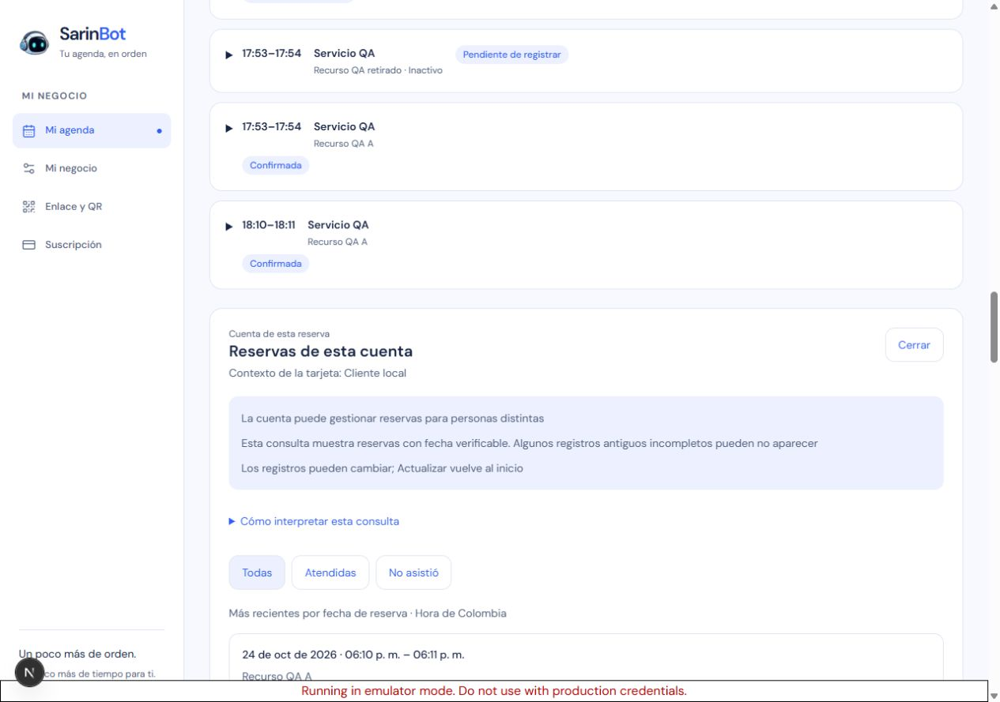
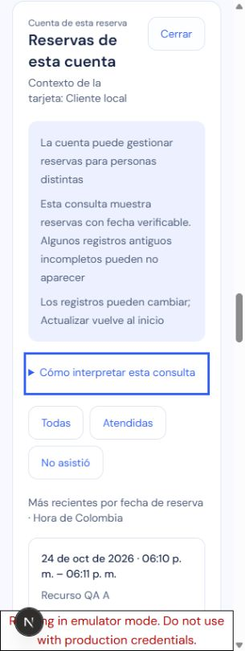
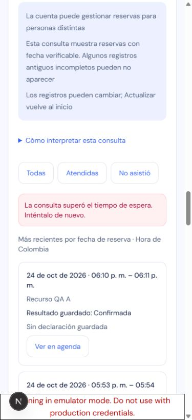

# S06 — consulta privada de reservas de una cuenta

Verificación del 24 de octubre de 2026, Colombia. Continúa el trabajo interrumpido en `7168154`, sobre P2–P5 y base `95a3a3e16f67f42520094b82ec5bb3b59a8d8d3f`. Fuente aislada: `C:/Users/Drean Skate/AppData/Local/SarinBot/fresha-p2-20261023/source`, rama `codex/fresha-p2-20261023`. El checkout documental E: no se ejecutó. Este reporte acredita implementación y QA local, **sin publicación S06 ni aceptación productiva**.

Desde el detalle de una cita con cuenta válida, el dueño abre un solo panel «Reservas de esta cuenta». La lectura privada autoriza el vínculo en cada página y devuelve únicamente fecha, recurso, estado guardado y clase de beneficiario. No es un expediente de una persona ni un historial completo: las reservas antiguas sin campos indexables pueden quedar fuera y las páginas no comparten un snapshot global.

## Verificación automatizada

Node 24.22.0, pnpm 11.23.0 y herramientas instaladas del lock. No se añadieron dependencias. SHA256 de `pnpm-lock.yaml`: `f035b6bd0ddb862b899be3e15ec8115cf0a47ac508f8d1e644899aa902e12358`, conservado. Los recuentos focales se solapan con la suite completa y no se suman.

| Gate | Resultado observado |
| --- | --- |
| Suite completa, equivalente a `pnpm test`, Vitest instalado con `--configLoader runner --maxWorkers 2` | 3.900 aprobadas, 32 omitidas; 243 archivos aprobados y 4 omitidos; exit 0, 273,05 s |
| Integración dashboard y regresiones vecinas, seis suites | 114 aprobadas; exit 0 |
| Modelo/dominio/doble de memoria, tres suites | 49 aprobadas; exit 0 |
| Hook/panel, dos suites | 57 aprobadas; exit 0 |
| TypeScript aplicación y build Next 16.4.1 | Ambos exit 0; build 47,636 s |
| Reglas y Admin SDK contra Firestore oficial emulado | 30 aprobadas en dos archivos; exit 0, 136,62 s |
| Worker completo | 156 aprobadas, cero fallos/omitidas; exit 0 |
| Worker tipos y dry-run con `--containers-rollout=none` | Ambos exit 0; no construye ni publica un Container |

Evidencia externa preservada en `../work/s06-resume-*-final.log`, sus JSON de resultado y `../work/s06-resume-20261024/`. El runner comprueba versiones instaladas y scripts, usa entorno sintético aislado y conserva el lock. La suite completa comenzó antes de dos correcciones de tipos de fixtures; sus suites afectadas volvieron a ejecutarse después y pasaron, al igual que tipos y build. No cambió código de producto durante los gates ni el recorrido de navegador.

El primer typecheck encontró seis errores de pruebas: cliente opcional en un literal conocido y fila tipada `Appointment` sin la firma de índice exigida por el doble. Se conservó el log fallido; `satisfies Appointment` y un spread del fixture corrigieron el contrato de prueba sin debilitar tipos de producción. La revisión independiente los incluyó. Se preservó el RED histórico de Task 6, 20 fallos/90 aprobadas, y su GREEN posterior de 114.

El intento histórico completo de Firestore de las 07:47 UTC falló; el diagnóstico focal posterior no cerraba ese gate. Esta reanudación ejecutó de nuevo **el runner fuente completo**, sin suprimir pruebas ni ampliar plazos, y aprobó las 30. Run nuevo: `s06-qa-runs/2026-10-24T22-51-41-543Z-e0776a/rules-result.json`. No se atribuye una causa no demostrada al fallo histórico. Se conservan avisos existentes de `react-test-renderer`, metadata y tipo de módulo.

Las pruebas de almacenamiento cubren D1/SQLite reales locales y Admin SDK emulado, 45 filas/empates, 1.001 reservas, ancla modificada, privacidad y errores. El EXPLAIN del SQL realmente generado acredita los índices aditivos `app_client_record_all` y `app_client_record_status`; no prueba capacidad de producción. No se alteran citas, políticas, cuota o auditoría mediante el lector.

## Navegador real

Chrome sobre `http://127.0.0.1:3046`, Firebase Auth/Firestore de `demo-sarin-bot`. Runner propio con guard de red local y sin inferencia, contactos externos, cobros o datos de producción. Run: `s06-qa-runs/2026-10-24T22-54-28-259Z-29e2fd`. Se prepararon cuatro cuentas y 47 citas sintéticas de dos negocios; 45 pertenecen a la cuenta consultada.

- Apertura explícita desde la cita: foco en Cerrar y una página de 20 filas. Continuación reemplazó la página: **20/20/5**, sin botón de continuación en la última. El fixture contiene 27 reservas de la misma hora. «Atendidas» mostró 13 y «No asistió» 12, conforme a los estados guardados; «Todas» volvió al inicio.
- Advertencias de cuenta/beneficiarios, cobertura incompleta y cambios entre páginas siempre visibles. Ayuda cerrada inicialmente. Se observaron recurso inactivo, recurso anterior y menor representado sin exponer su nombre, contactos o intake en el panel.
- Una respuesta real 200 se sustituyó localmente por 503: aviso de error y conservación de las 20 filas. Actualizar recuperó la lectura real. Otra respuesta 200 retenida superó el plazo y mostró el aviso de espera agotada, conservando 20 filas. El plazo exacto y limpieza se atribuyen a tests con timers; la primera espera del locator del harness venció antes de los diez segundos y no se contó como fallo del producto.
- Vacío: se sustituyó explícitamente una respuesta válida por otra del mismo scope con `rows:[]/nextCursor:null`; mostró «No hay reservas verificables para este filtro». Es simulación de transporte, no una cuenta realmente vacía.
- Con una respuesta 200 retenida, **Anterior** cambió al día 23 y desmontó el panel. Liberar la respuesta y volver a Hoy no lo restauró. Un primer intento con `fill` de fecha no acreditó transición y no se cuenta; la transición observada fue por el botón Anterior.
- «Ver en agenda» de una reserva del 23 cerró el panel, cargó ese día por la Agenda y enfocó el summary abierto de la tarjeta canónica `s06-record-a`, tenant/fecha correctos. No se inyectó el DTO de consulta como cita. Escape devolvió el foco a «Reservas de esta cuenta» en la tarjeta de origen.
- Cerrar sesión durante otra respuesta 200 retenida eliminó el panel y dejó la pantalla de acceso; liberar la lectura no devolvió datos privados. No se acredita recorrido visual con la segunda cuenta: las denegaciones y cambios de cuenta se probaron en backend y componentes.
- Anchos 1280/390/320: sin desbordamiento horizontal; anchos de documento 1265/375/305. Cerrar y tres filtros miden 44 px de alto. Se verificaron Tab, foco visible y Escape. **Zoom nativo 200 % y lector audible no observados**, sin sustituirlos por una emulación de viewport.
- La conservación del PATCH de asistencia al cerrar el panel, barrera síncrona, invalidación y callbacks tardíos se acreditan en las pruebas de componentes reales con transporte simulado; en este recorrido solo se hicieron consultas, no escrituras de asistencia.

Verificación final de inventario: **69 documentos, cuatro cuentas y 47 citas**, hashes conservados, `immutableMismatchCount=0`, cero cabezas y cero eventos de asistencia. Estados sin cambios: 21 confirmed, 13 completed, 12 no_show y una cancelled_by_owner. No se sembraron cuotas; su conservación se acredita en pruebas servidor. Evidencia sanitizada: `work/s06-resume-20261024/browser-result.json` y recibos de fixture del run. No se guardaron headers de autenticación.

## Revisión, límites y siguiente etapa

Una revisión independiente de todo S06, base `95a3a3e` a `7168154` más integración pendiente y correcciones de pruebas, no encontró defectos Critical/Important. Informe externo: `work/s06-resume-20261024/final-review.md`. Mejora menor diferida: al terminar una operación temporal de agenda, la consulta puede volver a la primera página aunque la escritura fuera ajena o fallara; pierde posición de lectura y hace otra consulta acotada, sin escribir datos ni ampliar el scope.

Se mantuvo la secuencia real ya implementada, en lugar de repetir P2 desde el handoff atrasado. Se conservan evidencias/runner externos. No se auditó o reparó legado productivo ni se promete completitud. La publicación requiere reconciliar runtime/CI, respaldo privado restaurable e índices D1 antes de la aplicación. Firestore productivo sigue fuera del despliegue de datos; no se cambia backend como fallback. Rollback conserva índices/citas/auditoría. No hubo push, migración remota ni despliegue en esta reanudación.

Limpieza: interceptores retirados, viewport restaurado, sesión sintética cerrada y pestaña propia cerrada. Se detuvo el launcher mediante su recibo; comprobar recibo `stopped` y puertos propios antes de otra ejecución. No se limpiaron ramas, evidencias ni datos históricos del usuario.
